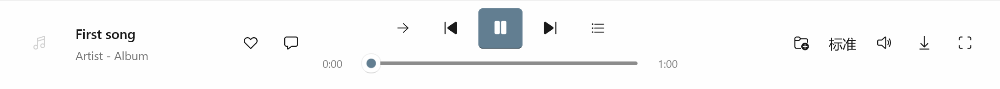
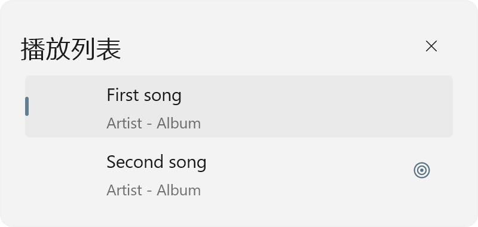

# 图标对齐、播放队列与收藏专辑

2026-10-20，0.2.5.0，Windows 10 22H2，x64。源码位于 `E:\NetEaseNEXT_Dev`，本轮未提交或推送。

## 图标及播放栏

上一轮只核对了 FontIcon 控件外框，漏掉了可见字形的位置。字体子集生成时重算了实际轮廓边界，但仍使用原字体的零左边距，造成每个图标不同程度地偏左。现从字体源头恢复字形在设计方格中的位置，同时统一垂直度量，未给各按钮叠加补偿 Margin。

`E8FD` 原先误映射为“文件夹＋”，现恢复为列表图标；`E8F4` 继续表示“收藏到歌单”。播放队列功能保留，底栏和独立播放页都能点击列表按钮展开、再次点击收起，歌曲数量及当前歌曲正确，收起时释放面板绑定。

实测播放三角形使用墨迹重心，其他图标使用墨迹边界中心。播放/暂停、上首、下首、模式及列表图标在底栏与播放页的偏差均小于 1 DIP，按钮垂直中心一致。68 个码位的字体边界与左边距检查通过。已查看真实 WinUI 渲染的浅色、深色、播放及暂停状态。

## 收藏的专辑

侧栏增加“收藏的专辑”，沿用原生导航、专辑卡片及已有专辑曲目页，增加对应的常规/选中态内置图标。通过固定依赖的 `album_sublist` 读取账号已有收藏，每页 48 张，支持分页、空集合、失败保留及取消请求。收藏专辑缓存随会话隔离；登录后刷新，退出账号时清空展示并提示登录。只在打开页面时请求，后台恢复遵守既有中断机制。

真实账号读取到首批 48 张专辑；打开首张专辑得到 6 首歌曲。此功能展示账号已收藏的专辑，未增加新的收藏/取消收藏操作。

收藏专辑页面截图保留在本地验证目录，包含连接账号的收藏内容，未随源码公开。

## 从自建歌单移除歌曲

曲目现有原生 ContextFlyout 增加“从歌单移除”。右键和系统触摸长按共用此菜单；只对已登录的歌单创建者显示。在其他人的歌单、专辑、搜索结果及播放队列中隐藏。

菜单打开时捕获歌单 ID、歌曲 ID 和会话；提交前再次核对创建者、当前位置、会话及可见曲目，避免使用已过期的菜单。请求只提交对应的 `playlist_tracks` 删除操作；同一歌单的移除串行处理，加载分页时不发起移除。服务器确认后更新当前行、完整歌曲 ID 列表、总数及分页偏移；失败保留原列表并显示错误。若提交期间隐藏或重新进入页面，按需重新加载，保留当前音频及播放队列。

验证使用本地管道服务替身，没有删除真实账号的歌曲。覆盖服务器拒绝、非创建者、过期菜单、成功后列表和计数更新、播放队列保留。原生菜单已实际打开并核对选项状态；未进行实体触屏长按验收。RenderTargetBitmap 不能完整记录原生菜单浮层的背景，菜单透明截图不作为视觉通过证据。

## 交互与视觉取舍

任务是从原生播放器直接查看已有收藏、调整自己的歌单，并可靠地打开当前队列。沿用既有 WinUI 控件、触控尺寸、主题色与页面过渡；菜单保留系统动效，没有新增常驻动画或后台轮询。

计数以一次点击/右键为一步，页面切换另计；不含系统认证步骤。

| 任务 | 原路径 | 本次路径 | 结果 |
| --- | --- | --- | --- |
| 查看收藏专辑 | 应用内无入口 | 侧栏一次点击 | 已收藏专辑可直接浏览，点击卡片查看歌曲 |
| 移除一首歌 | 编辑曲目、选中、移除选中、保存，共 4 步 | 右键/长按、从歌单移除，共 2 步 | 原地更新，失败保留内容 |
| 查看当前队列 | 一次点击，但图标误成文件夹 | 列表图标，一次点击 | 入口语义恢复，原队列保留 |

主 Agent 完成一轮实际渲染自检并修正截图过渡帧；未进行独立设计评审。没有改变整页布局或建立新设计规范，没有装饰文案需要删减。过程采用 oil-ui-pro 的存量项目流程；未新增视觉方向或要求用户选择方案。

## 验证与产物

- [专项第 1 轮](library-2026-10-20-run1.json)、[第 2 轮](library-2026-10-20-run2.json)、[第 3 轮](library-2026-10-20-run3.json)：每轮 41 项通过，含实际字形像素检查及真实收藏专辑读取。
- [完整回归](integration-library-2026-10-20.json)：136 项通过；本轮未额外运行 20 秒后台采样。
- 10 项 Node 测试通过，包括收藏专辑请求分页、单曲移除精确请求体及服务器错误保留。无真实账号写入。
- 发布构建通过，保留既有 `Player.cs` CS1998 警告。
- [MSIX 检查](msix-library-2026-10-20.json)记录签名、包内字体、程序与接口桥接文件的 SHA256；[Shell 资源检查](msix-library-icons-2026-10-20.json)核对 5 项资源契约。

签名产物为 `E:\NetEaseNEXT_Dev\artifacts\msix\NetEaseNEXT-0.2.5.0-x64.msix`，复用有效期至 2043-10-20 的证书。同目录提供匹配的 CER、INSTALL.txt 和 SHA256SUMS.txt。未安装此包或修改系统证书信任。
