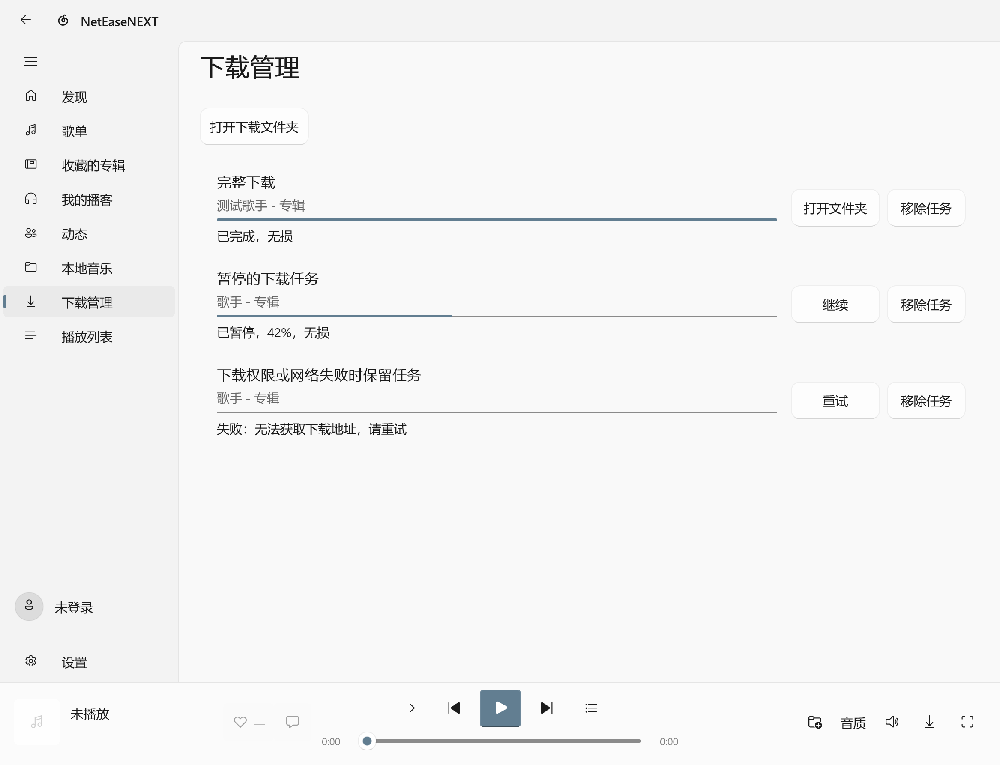
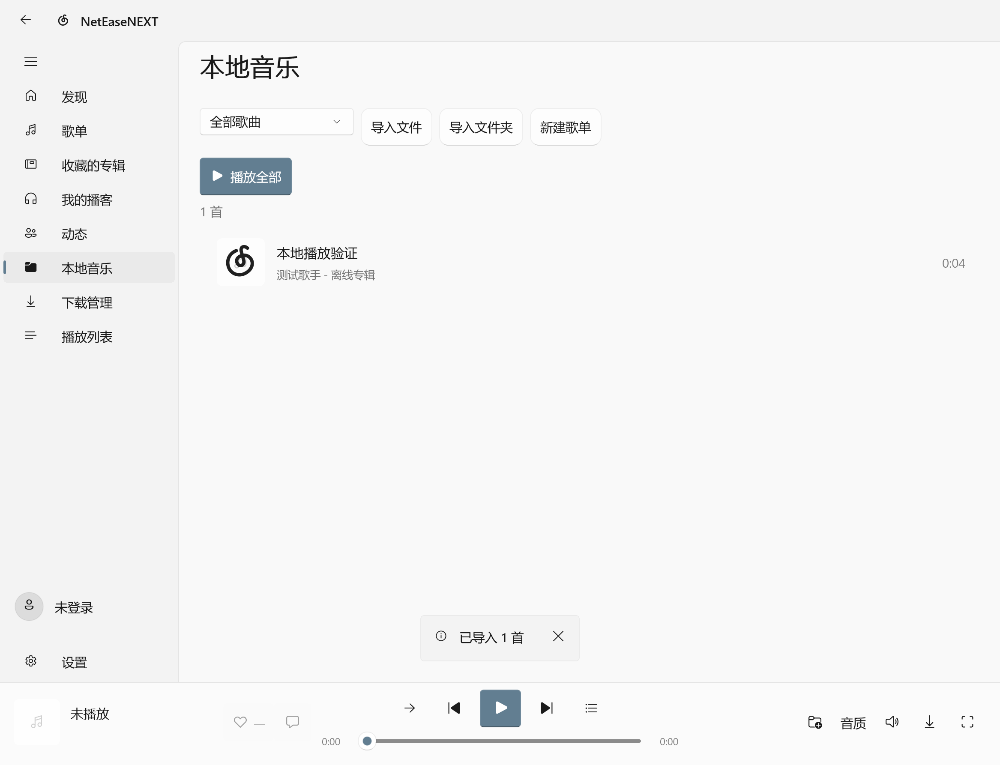
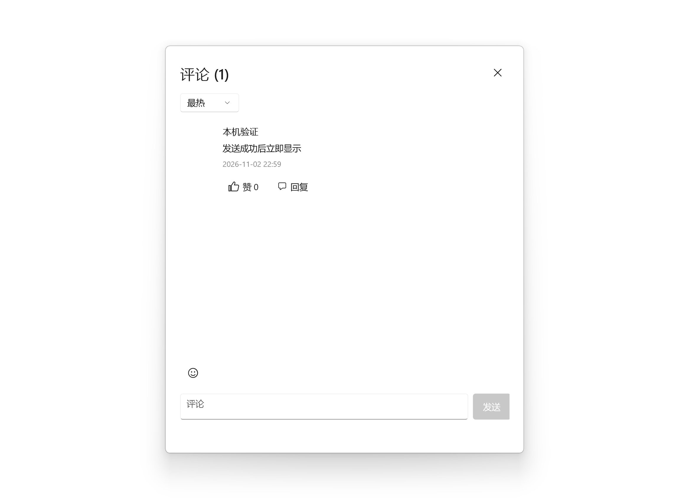
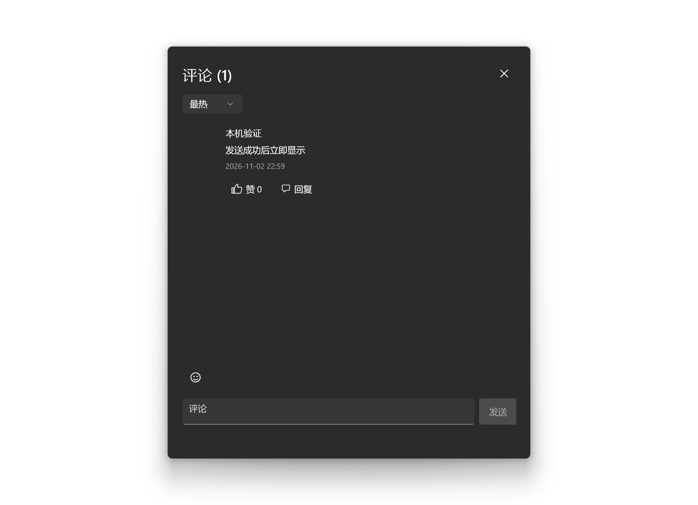

# 0.3.0：纯 C# API、下载与本地音乐

2026-11-02，Windows 10 x64。开发目录 `E:\NetEaseNEXT_Dev`。已生成并安装签名 MSIX 0.3.0.1，账号、设置和原音乐文件保留。没有提交或推送 Git，也没有发布到 GitHub。

## 移植结果

`NetEaseNEXT.Api` 使用 HttpClient、C# 加密和二维码实现，保留原接口返回形状、业务错误码、会话 Cookie、取消和缓存边界。读取最多并行 4 项，远端写入按顺序排队。EAPI、WEAPI、XEAPI 均已移植；XEAPI 获取并校验服务器密钥，写请求使用新验证令牌。主应用、发布脚本和 CI 均不依赖 Node/npm，旧 JS 桥接和包清单已从源码移除。Windows MediaPlayer 继续负责音频。

59 个端点以旧依赖 4.41.1 的固定输入/输出夹具核对，EAPI/WEAPI 有固定加密向量。保留上游许可和托管依赖说明，见 [依赖与许可](../third-party/DEPENDENCIES.md)。未卸载系统其他软件使用的 Node。

## 截图需求对应

| 原需求 | 本次实现及验证范围 |
| --- | --- |
| 下载绑定歌曲信息、FLAC 标签、独立管理页 | 独立网络下载，不复用播放缓存；长度/MD5 通过后写标题、歌手、专辑、歌词和封面，再完成重命名。WAV 与 FLAC 标签读回、断点字节一致和任务完成条件通过。 |
| 评论按热度/时间排列 | 原生排序下拉框，对应最新和最热接口；真实接口读取与本地 UI 分支通过。 |
| 发送评论即时显示 | 成功后插入返回评论，合并刷新时保留待同步项；失败保留草稿。使用隔离接口验证，没有代用户发评论。 |
| 直接指定字体文件、及时刷新系统字体 | 导入 TTF/OTF/TTC 到应用自己的字体目录，DirectWrite 更新集合；下拉打开、手动刷新及字体变更通知触发更新。安装版 `ms-appdata:///local/Fonts/...` 实际字形渲染通过。 |
| 重复收藏提示 | 收藏前读取歌单曲目，只添加缺失项；502/512 后再次确认全数已存在才显示已收藏，其他错误保留。未向真实歌单写入。 |
| 发送动态接口 | 已移植 XEAPI、密钥签名验证、请求构造及令牌获取；拒绝响应不会假报成功。真实密钥和令牌初始化通过，实际发布仍需用户操作验收。 |
| 歌词无操作 5 秒返回当前行 | 单次计时，滚动/按键重新计时，隐藏/退出页面停止；暂停状态下恢复跟随也通过。可见返回按钮已移除。 |
| Node 生命周期与功耗 | 应用不启动 Node、不监听本地 API 端口。安装版专项、启动及完整回归的进程采样均未发现 Node 子进程。 |
| 界面原生一致 | 保留 WinUI 原生控件与深浅主题；评论布局、44 DIP 发送按钮、下载进度和操作对齐、本地库提示位置完成实图复核。见 [界面约定](../DESIGN.md)。 |
| 下载可选择音质 | 歌曲下载菜单选择音质，偏好独立于播放；任务固定所选音质，显示实际返回音质，权限/试听限制保留。 |
| 离线播放器、本地歌单 | 文件/文件夹导入、路径去重、命名歌单、持久化、离线播放、封面及内嵌/同名歌词；从列表移除不删除原文件。隔离本地库、无 API 播放及原文件保留检查通过。 |
| 评论关闭与发送位置 | 右上关闭、输入框旁发送，列表占用可伸缩区域；深浅主题截图及边界检查通过。 |
| 清除加载更多按钮 | 搜索、曲目、专辑/歌手、社交列表接近底部自动继续；小歌单不超过 500 首自动补齐，大列表继续按页虚拟化。真实搜索滚动续载和 200 首小歌单完整加载通过。 |
| 后续补充：区分本地音乐图标 | 本地音乐使用 Fluent Folder，普通态为线框、选中态为实心，与在线歌单音符区分。普通/选中、深浅主题实际渲染通过。 |

## 验证结果

- [原生 API](native-api-2026-11-02.txt)：80 项通过，包括真实匿名搜索、推荐、播放地址、歌词、歌单、二维码 key、评论排序，以及只初始化不发布的动态请求。
- Release 发布构建：0 警告、0 错误；[构建日志](native-build-2026-11-02.txt)。[MSIX 打包和签名](msix-build-2026-11-02.txt)成功。
- 开发版新增专项连续三轮各 22 项通过：[第 1 轮](native-features-2026-11-02-run1.json)、[第 2 轮](native-features-2026-11-02-run2.json)、[第 3 轮](native-features-2026-11-02-run3.json)。
- 通过 Windows 包激活管理器启动已安装 MSIX：0.3.0.0 的[启动及托盘 28 项](installed-startup-2026-11-02.json)、[完整回归 151 条记录](installed-full-2026-11-02.json)均无失败。完整回归含 149 条断言和 2 条资源采样，覆盖真实登录态读取、真实媒体播放、SMTC 和社交读取。随后仅更新本地音乐图标，安装 0.3.0.1，再通过[新增专项 22 项](installed-features-2026-11-02.json)和[侧栏主题 114 条记录](installed-sidebar-2026-11-02.json)（60 条断言、54 条图标采样）。
- [安装包内容检查](package-native-runtime-2026-11-02.json)：629 个条目，未包含 Node、node_modules、旧桥接或 npm 锁文件。三次安装版检查均有独立进程报告，Node 子进程数为 0。
- 完整回归的隐藏播放采样约 20 秒，主进程累计 CPU 125 ms、工作集 272.8 MiB、私有内存 185.5 MiB。仅代表本机这一轮采样，不是功耗基准。

启动检查早期的总请求计数包含了并发推荐页请求，改为单独统计账号验证请求后通过；头像和账号状态本身正常。安装版启动检查首次有一项托盘 owner 前台焦点断言失败，随后的独立复测 28 项全部通过；保留为 Windows 自动前台焦点检查的偶发现象，没有据此声称任意桌面环境都已验证。

以下图片来自真实 WinUI RenderTargetBitmap，使用隔离测试数据，不是设计效果图。已检查布局并完成独立 UI 复核：

| 下载管理 | 本地音乐 |
| --- | --- |
|  |  |

| 浅色评论 | 深色评论 |
| --- | --- |
|  |  |

## 本机迁移与分发

安装包：`artifacts/msix/NetEaseNEXT-0.3.0.1-x64.msix`，约 89.8 MiB。签名证书沿用既有绑定，没有新增信任设置。SHA-256：`6F4F3E26634873E71D5E76CC00A6C33D7DAC228ABD73D1EECB041477D464718F`。

便携程序：`artifacts/win-x64/NetEaseNEXT.exe`，须保留同目录全部文件。

旧安装器记录和默认旧部署目录已不存在。本次将准确匹配的旧开始菜单链接和旧手工 AppUserModelId 注册移出活动位置，并备份在 `%LOCALAPPDATA%\NetEaseNEXT\MigrationBackups`。没有删除账号、设置、下载音乐或 Windows 管理的安装目录。开发版在已有 MSIX 时复用包身份，重复运行后仍只显示 `NetEaseNEXT_1wr5cf65fxq72!App` 一个开始菜单入口。

复核安装版可在 Windows PowerShell 5.1 串行运行 `verification/run-installed-check.ps1 -Mode Features`、`-Mode Startup`、`-Mode Full`。不要并发运行，应用诊断输出使用同一个文件。

## 验证边界

没有向真实账号发布动态、评论、私信、点赞或修改歌单；这些写入使用协议夹具及本地替身验证。真实写入是否被服务端账号权限或风控接受，仍需用户手动验收。下载没有代为获取受限歌曲；FLAC 标签测试使用最小元数据样本，离线实际播放使用生成的 PCM WAV。Windows 11 材质、实体触屏、多显示器和不同音频设备未做实机验证。
