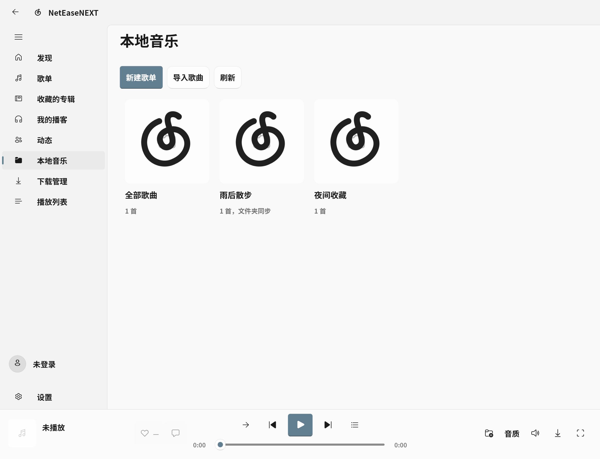
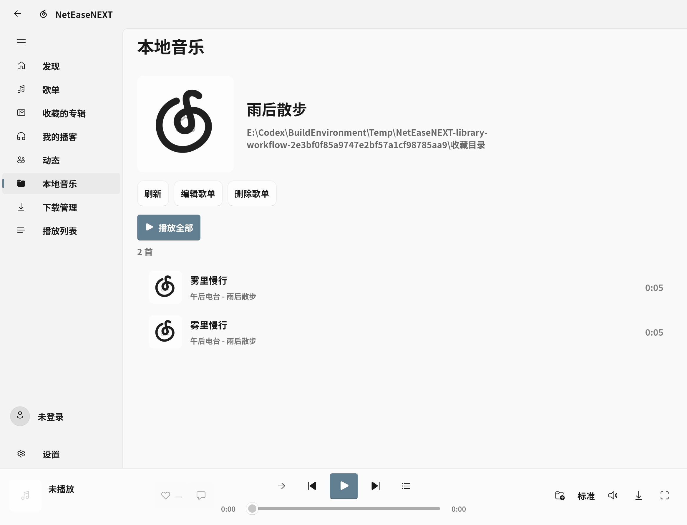
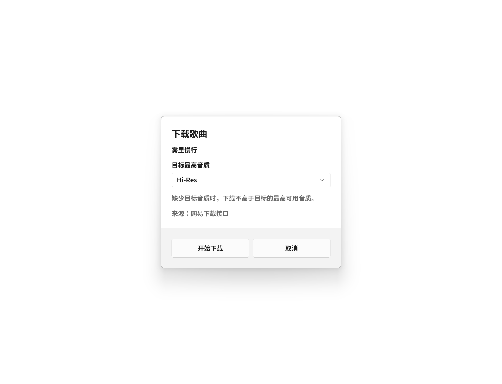
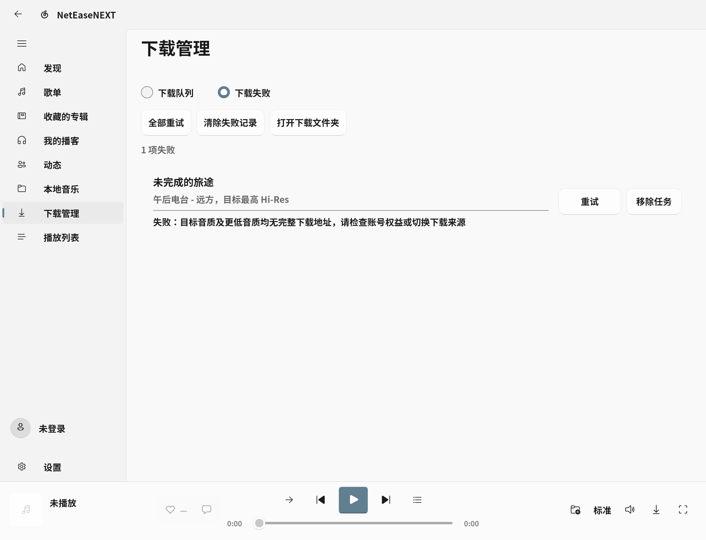

# 0.3.1：本地歌单、目录同步与下载管理

2026-11-03，Windows 10 x64。已构建、签名并安装 MSIX 0.3.1.0。源码仍在 `E:\NetEaseNEXT_Dev`，没有提交、推送或发布 GitHub Release。

## 本地音乐

- 首页改为原生歌单封面卡片，“全部歌曲”和已有手工歌单都保留，不再用下拉框充当歌单首页。
- 新建和编辑集中提供名称、封面、文件夹绑定及是否包含子文件夹。封面保存应用副本；删除歌单、取消绑定或移除列表项不删除用户原音频。
- 绑定目录使用 FileSystemWatcher 监听新增、删除、重命名和文件变化，合并连续事件后扫描。以路径、长度和修改时间复用未变化的标签，保留上次有效结果以处理暂时不可读的目录。
- 提供手动刷新；隐藏窗口或离开本地页面时停止监听，恢复时补扫。每个目录最多读取 10000 首，达到限制时提示。
- 手工歌单可以添加已导入歌曲；目录歌单随文件夹变化，编辑时可取消绑定后转为手工管理。原版本的本地库格式兼容读取。

## 下载与播放

- 单曲和多选下载都会先确认目标最高音质，预填上次选择。不可用时按平台档位向下查找；先保留降档结果，再检查其与目标之间是否有更高可用档。拒绝试听片段和错误歌曲 ID。
- 正常队列和失败记录使用两个独立原生 ListView，共用任务行模板。修复了早期失败页只有计数、没有实际行的问题。失败行显示歌曲、目标音质、失败原因和单项重试/移除；失败页提供全部重试、清除失败记录。
- 正常队列提供全部暂停、继续、取消、清空全部。暂停保留临时文件；取消移除准确归属的未完成临时文件；清空队列保留已经完成的音乐文件。失败页的清除操作不影响正常队列。
- 任务保留来源与目标音质。暂停继续保留原来源；失败或取消后重试可使用当前设置的来源，并重新开始不兼容的临时文件。
- 完成文件先校验长度及可用 MD5，再写标签、歌词和封面。增加标签完成状态，暂停在标签写入之后时，继续操作不会错误地拿改过标签的文件校验原网络 MD5。
- 已完成文件登记到独立 `downloaded-library.json`，记录歌曲 ID、实际音质、路径、长度和修改时间；清空下载队列不清除该索引。
- 从在线入口播放同一歌曲时优先读取匹配的已下载文件，仍保留在线歌曲 ID，显示实际音质，不请求该歌曲的流地址、不再次写入播放缓存。显式切换其他音质尊重所选档位；已下载文件失效或无法解码时回退网络，保留原文件。

## MusicUnlock 同款网易直连

用户确认仅接入同款网易源，没有接入 QQ、酷狗、酷我或跨平台匹配。

设置的“下载来源”可在原有网易下载接口与 MusicUnlock 同款网易直连之间切换。后者独立实现其网易官方 GET 地址及码率降档方式：

- `https://music.163.com/api/song/enhance/player/url`
- 按目标尝试 999000、320000、192000、128000 的适用码率；实际格式及返回码率用于记录音质。
- 复用现有网易登录的选定 Cookie，始终只发往 `music.163.com`；禁用接口自动重定向，防止登录头被带到另一域名。下载音频的 HTTP 客户端不携带这些 Cookie。

核查参考是 MusicUnlock 的固定提交 [58c4f9b](https://github.com/Lin-M11/MusicUnlock/blob/58c4f9b6e13ffc8dd8bd86273f39fe9f585ec428/src/main/kotlin/musicunlock/ncm/NeteaseApi.kt) 及同提交的 NeteaseProvider.kt。没有复制其播放器、资源或可执行文件，也没有加入 Kotlin、Node 或 ffmpeg 依赖。

**同款直连接口不等同于全部 SVIP 档位均可用。** 能否返回完整音频及具体音质由网易账号权益和服务端决定；按码率的旧接口不保证覆盖 Hi-Res、母带等全部高阶档，因此保留原有高阶音质下载接口供切换。没有用用户账号实际下载 SVIP 曲目或代为发布内容。

## 验证

| 检查 | 结果 |
| --- | --- |
| [API 与加密检查](api-source-2026-11-03.txt) | 83 项通过，含真实网易直连响应、只向官方域发送选定凭据、非法码率拒绝 |
| 新流程专项 | [第 1 轮](library-workflow-2026-11-03-run1.json)、[第 2 轮](library-workflow-2026-11-03-run2.json)、[第 3 轮](library-workflow-2026-11-03-run3.json)各 32 项通过 |
| [原有新增功能回归](regression-features-2026-11-03.json) | 22 项通过 |
| [完整回归](regression-full-2026-11-03.json) | 151 条记录、无失败，含 149 条断言和 2 条资源采样 |
| [已安装 MSIX 专项](installed-workflow-2026-11-03.json) | 32 项通过，覆盖真实 MSIX 激活、目录事件及下载文件播放 |
| [已安装 MSIX 完整回归](installed-full-2026-11-03.json) | 151 条记录、无失败，Node 子进程为 0 |
| [数据保留检查](migration-preserved-2026-11-03.json) | session.bin、local-library.bin 的升级前后哈希相同 |
| [包内容](package-native-runtime-2026-11-03.json) | 无 Node、旧 JS 桥接、npm 锁文件或 node_modules |

专项使用隔离临时库、静音 PCM WAV、虚构曲名和接口替身，验证目录增删/重命名、保存失败回滚、音质降档、真实原生失败行、批量暂停/取消、写标签后恢复、清空队列保留文件索引、在线 ID 匹配离线音频及失效文件拒绝复用。真实文件选择器、实体触屏及实际 SVIP 曲目下载未做自动操作验收。

Release 发布构建 0 警告、0 错误。[发布日志](publish-2026-11-03.txt)、[打包日志](msix-build-2026-11-03.txt)。安装版隐藏播放约 20 秒采样，主进程累计 CPU 46.875 ms、工作集 275 MiB、私有内存 197.7 MiB；不是整机功耗或通用内存基准。

## 图片和独立评审

采用现有 WinUI 视觉，不另建控件模板。两轮独立评审修正对话框底部按钮至 44 DIP，并确认失败行完整。详情见 [评审与流程记录](library-workflow-2026-11-03/ui-review.md)。

| 本地歌单首页 | 目录歌单详情 |
| --- | --- |
|  |  |

| 下载前选择最高目标音质 | 独立失败列表 |
| --- | --- |
|  |  |

## 本机安装

包：`artifacts/msix/NetEaseNEXT-0.3.1.0-x64.msix`，约 89.9 MiB。

SHA-256：`CFC693097F0DDFBA9EC35B477C502E2AB3625AACC3EDE8AA713C5BBC45D9EDC4`。

使用既有签名证书，未增加信任设置。升级通过 Windows Appx 部署关闭旧应用并替换包，原登录会话和本地歌单文件保留。开始菜单仍只有 `NetEaseNEXT_1wr5cf65fxq72!App` 一个入口，没有重建旧 EXE 快捷方式。

安装版可用 Windows PowerShell 5.1 串行运行 `verification/run-installed-check.ps1 -Mode Workflow` 与 `-Mode Full`。本次所有修改尚未提交或推送。
