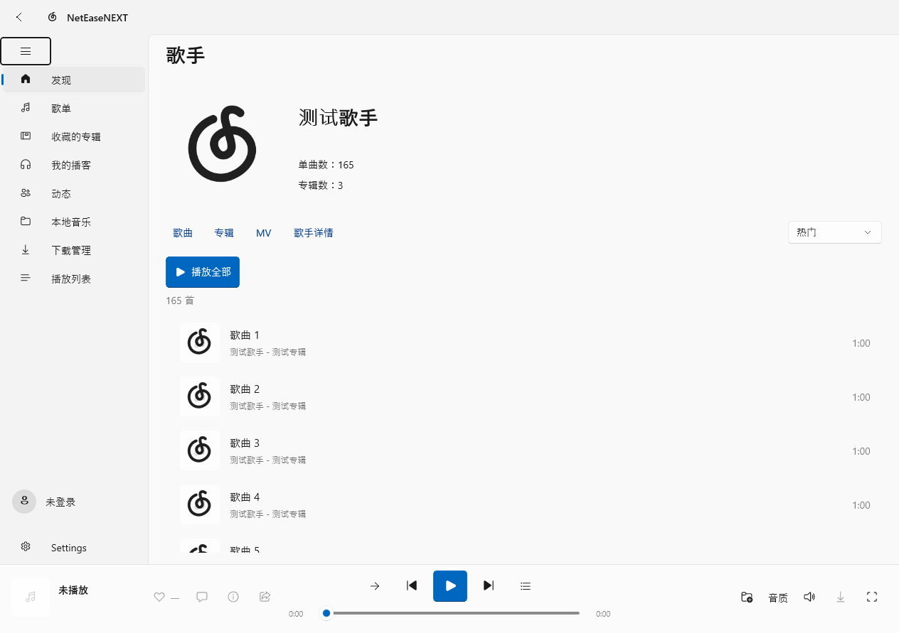
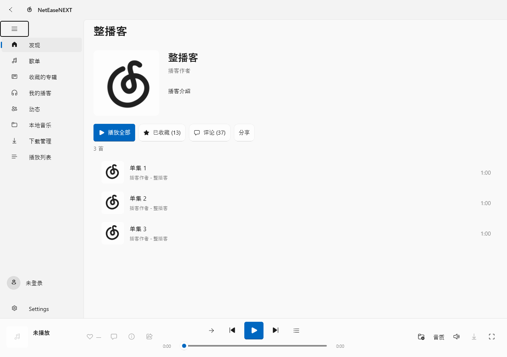
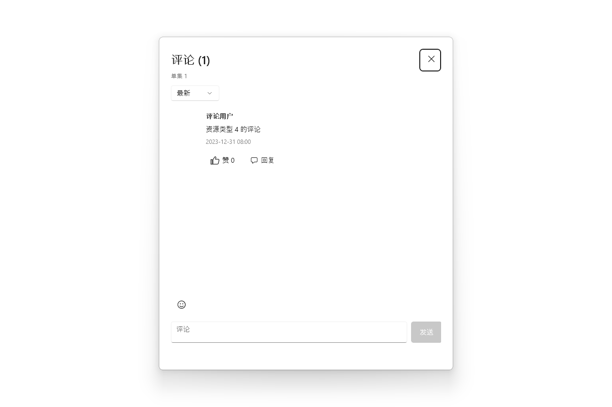
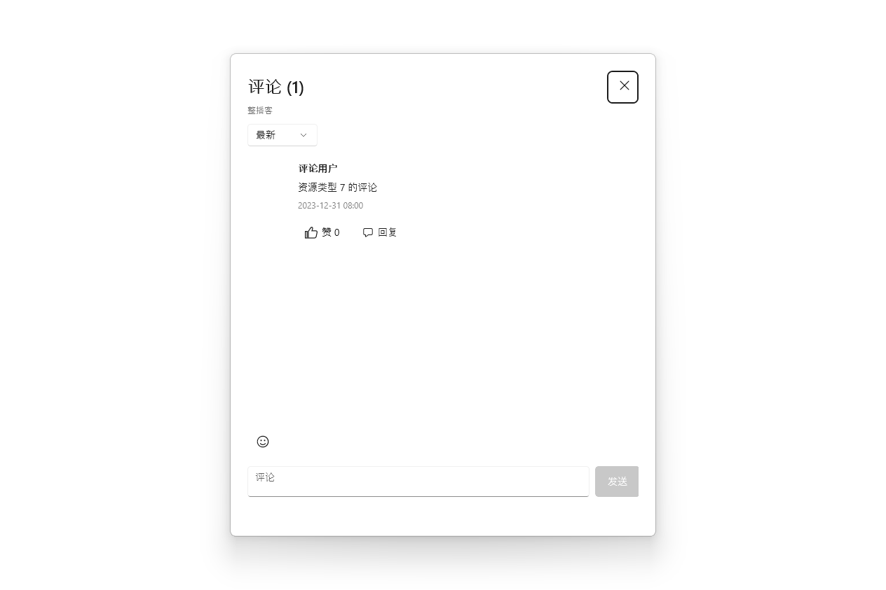
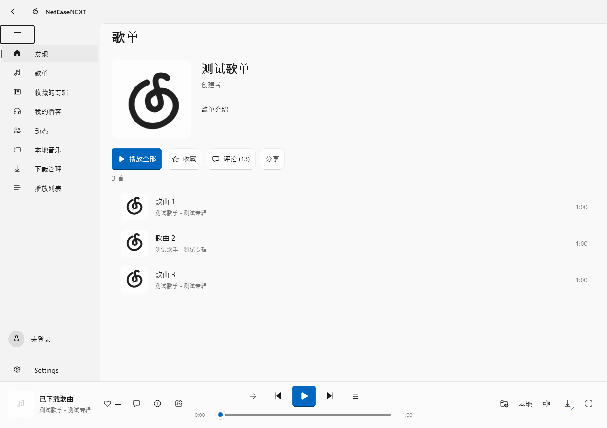
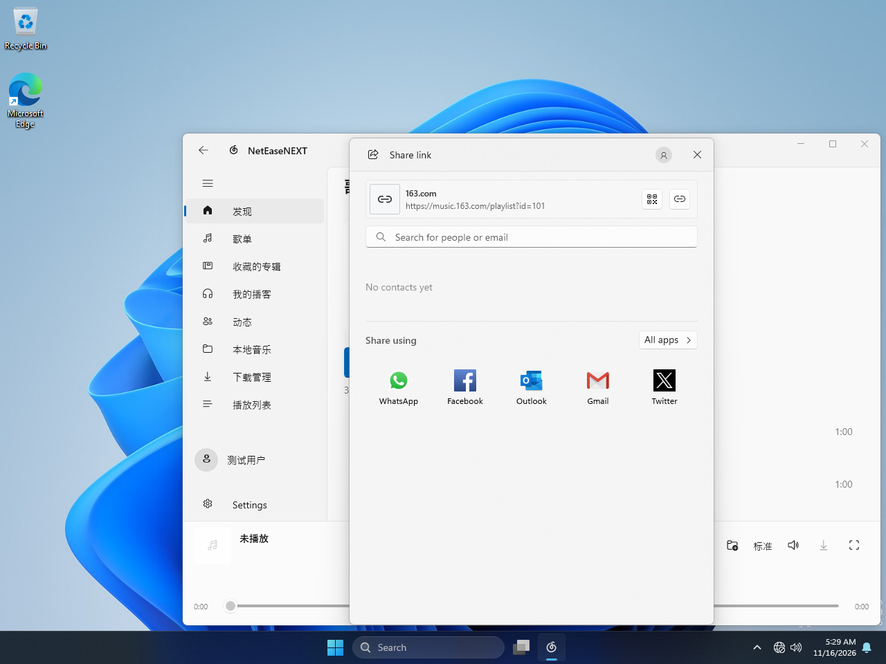

# 0.3.3.11 — 歌手目录、资源评论与分享

歌手详情的头像固定在标签内容之外，切换歌曲、专辑、MV 和介绍不再重新挂载或重复加载头像。歌曲改用分页完整目录，默认热门，右侧可选时间顺序；续页与播放全部保留服务端顺序，取消旧排序请求后不会混入结果。

专辑、歌单、整播客共用详情操作。专辑评论使用类型 3，整播客使用类型 7，播客单集使用类型 4；单集保存节目 ID，与实际播放的音频歌曲 ID 分开。单集右键菜单及播放控件可进入单集评论，播客详情顶部进入整播客评论。整播客收藏接入现有登录凭据，专辑及播客的已收藏图标与歌单一致。

详情和播放控件中的操作不再因普通页面导航或本地来源在线信息尚未加载完成而卸载、消失。用户关闭本地在线信息或确实离线时仍遵守原有开关。

歌曲、歌单、专辑、整播客、单集等支持复制链接和 Windows 系统分享；接口支持的资源提供“分享到动态”，先预览来源，再由用户确认发布，失败保留内容以便重试。本地已下载歌曲只分享对应在线资源，不暴露本地路径。

## 验证

- Release 构建零警告、零错误。
- [汇总及哈希](artist-sharing-2026-11-16/summary.json)：便携版 252 项，签名 MSIX 安装版 147 项，全部通过；安装状态 Ok，安装目录、MSIX 内和发布目录的主 DLL 哈希一致。
- [API 检查](artist-sharing-2026-11-16/api-read-checks.txt)：89 项全部通过，含 6 项真实公开只读请求，覆盖歌手热门／时间／后续页及专辑、整播客、单集评论。收藏、评论、动态发布的写入均用模拟数据，没有替用户实际发布内容。
- 在副屏的 Windows 11 / VirtualBoxSVGA 3D 虚拟机中安装并运行。正常交互模式通过 UI Automation 打开歌单，再打开系统分享，确认 Windows 分享面板显示 `playlist?id=101`，随后取消，没有选择收件人或发送。截图见下方。
- 尚未进行实体触摸屏验证；真实账号写操作仍取决于服务端权限及接口可用性。

## 截图

## 接口依据

- [artist_songs 实现](https://github.com/NeteaseCloudMusicApiEnhanced/api-enhanced/blob/main/module/artist_songs.js)
- [评论类型及资源分享文档](https://github.com/NeteaseCloudMusicApiEnhanced/api-enhanced/blob/main/public/docs/home.md)
- [Microsoft：桌面窗口中显示 UI 对象](https://learn.microsoft.com/en-us/windows/apps/develop/ui/display-ui-objects)
