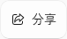
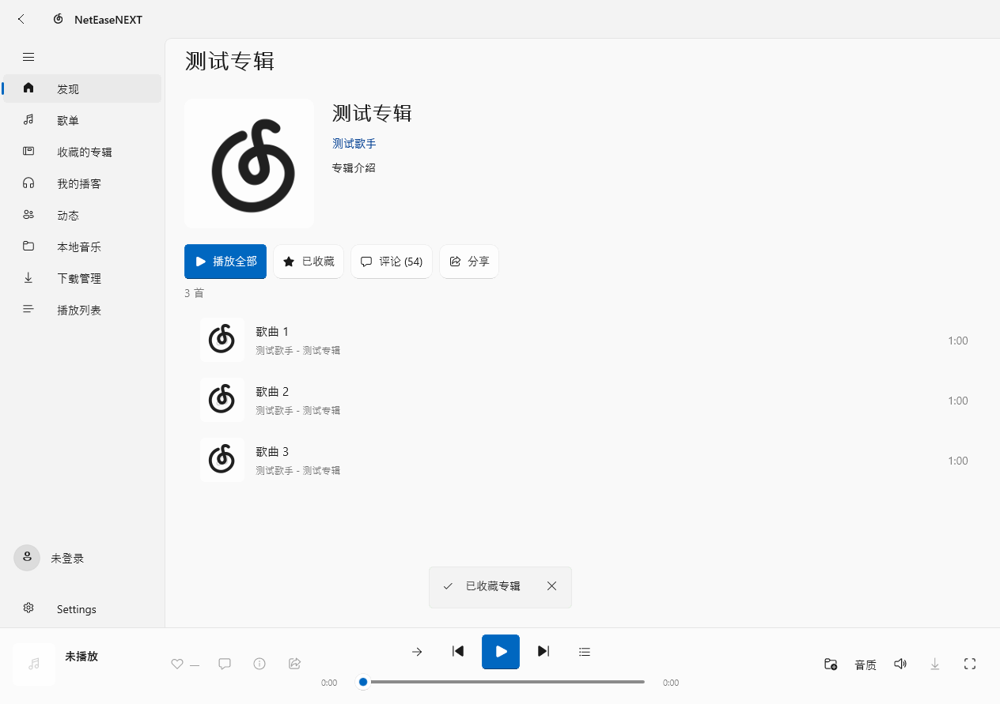
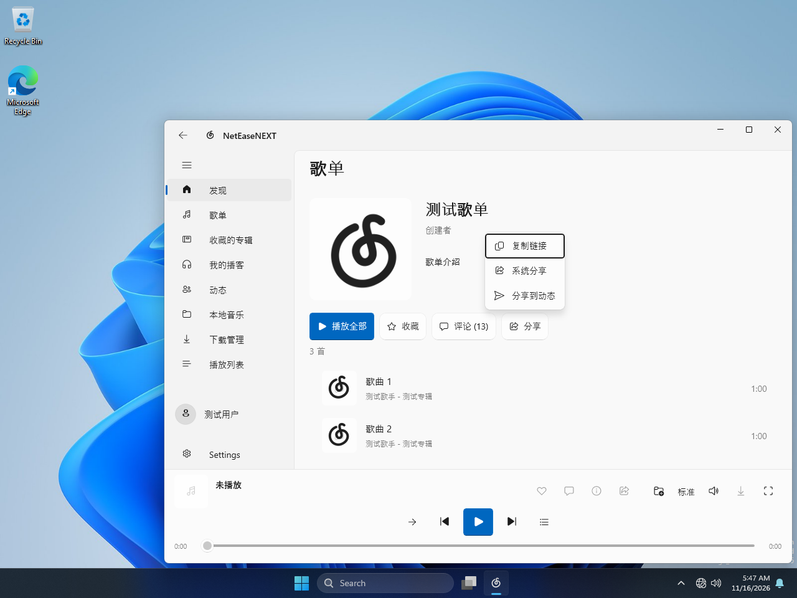
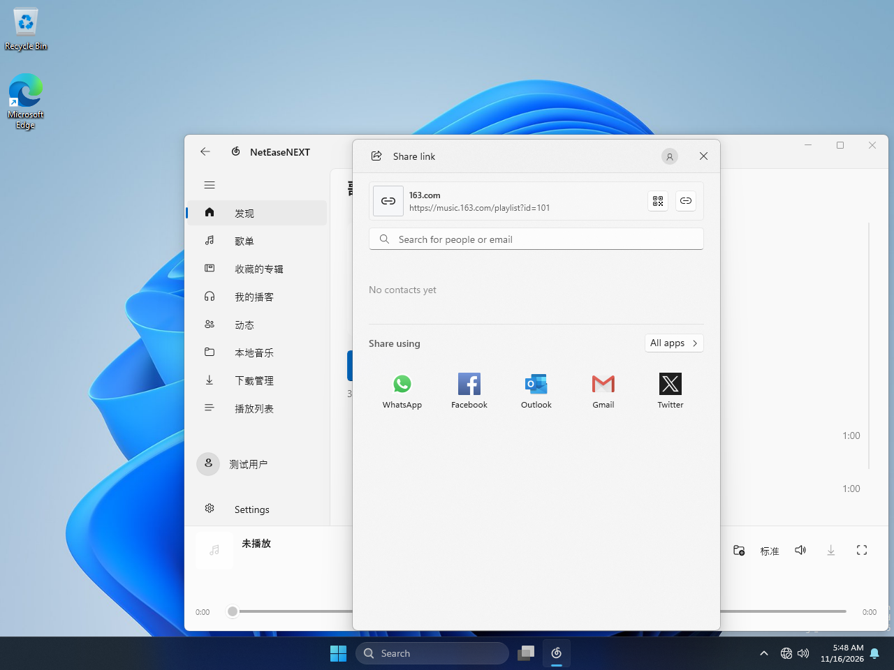

# 0.3.3.13 — 分享图标裁切修复

0.3.3.12 的详情分享按钮将默认 SymbolIcon 放进固定 16×16 的布局，用户在虚拟机中发现图标切边。改成与播放栏相同的包内 Fluent 分享字形，使用明确字号并移除强制宽高；相关分享菜单也使用同一字形。

安装版实际测得详情图标自然大小为 16×18，布局留出的大小也是 16×18，没有压入 16×16 的框。新增自然测量尺寸检查，连同歌手、资源评论、收藏、按钮稳定性和分享流程检查共 36 项，全部通过。实际按钮与菜单截图如下，未通过图片编辑补画或修补图标。

Release 构建零警告、零错误；签名 MSIX 安装状态 Ok，安装目录、MSIX 内和发布目录的 DLL 哈希一致。Windows 系统分享面板打开后显示正确歌单链接，并通过关闭按钮取消，没有发送内容。API 源码未改动，沿用 [0.3.3.12 的 89 项 API 检查](share-icons-2026-11-16/api-read-checks.txt)；完整功能回归见 [0.3.3.11 验证记录](fixes-2026-11-16-artist-sharing.md)。

[汇总与哈希](share-clipping-2026-11-16/summary.json) · [安装版 36 项报告](share-clipping-2026-11-16/installed-share-clipping.json)

