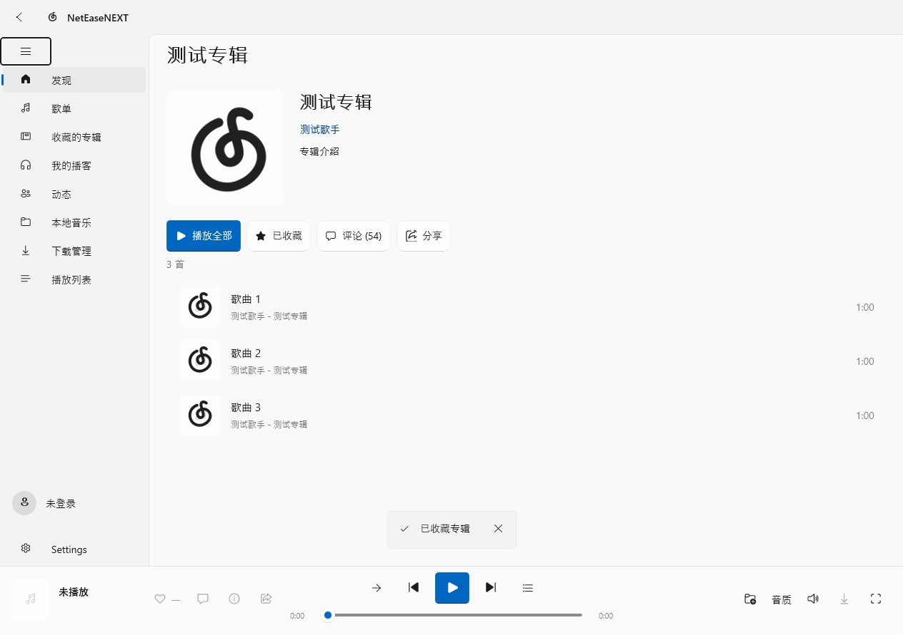
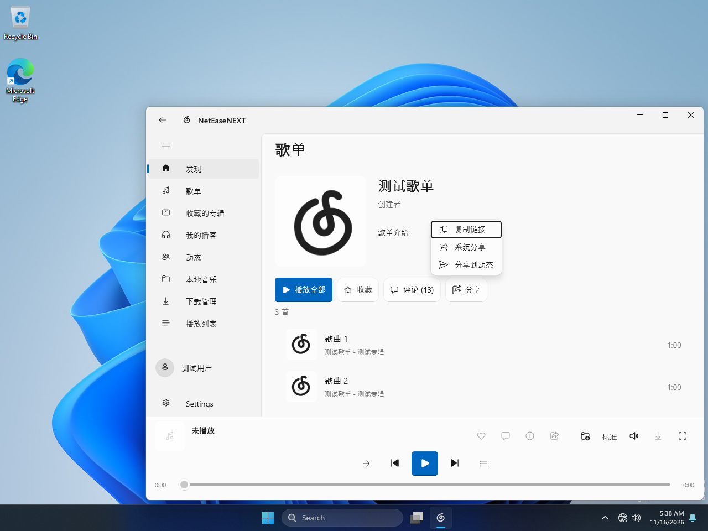
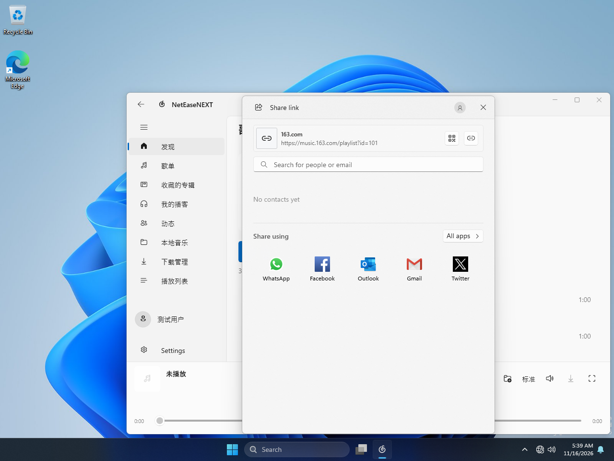

# 0.3.3.12 — 分享图标

在已通过完整回归的 0.3.3.11 上补齐原生分享图标：详情按钮显示 Share 图标与“分享”文字；歌单／目录封面、歌曲列表和播放队列的分享菜单使用同款图标。复制链接、系统分享、分享到动态分别使用 Copy、Share、Send 图标。按钮保留可访问名称及 44 像素触摸高度。

Release 构建零警告、零错误。签名 MSIX 在 Windows 11 3D 虚拟机安装状态 Ok，重新执行 35 项歌手、评论、操作区及分享检查，全部通过。安装目录、MSIX 内及发布目录的 DLL 哈希一致；API 程序集与完整回归基线逐字节一致。详情与菜单经过实际渲染检查，原生 Windows 分享窗口重新打开并核对链接，随后点击窗口关闭按钮，没有发送内容。

[本次汇总](share-icons-2026-11-16/summary.json) · [安装版 35 项报告](share-icons-2026-11-16/installed-share-icons.json) · [完整功能回归基线：252 项便携版、147 项安装版、89 项 API](fixes-2026-11-16-artist-sharing.md)

