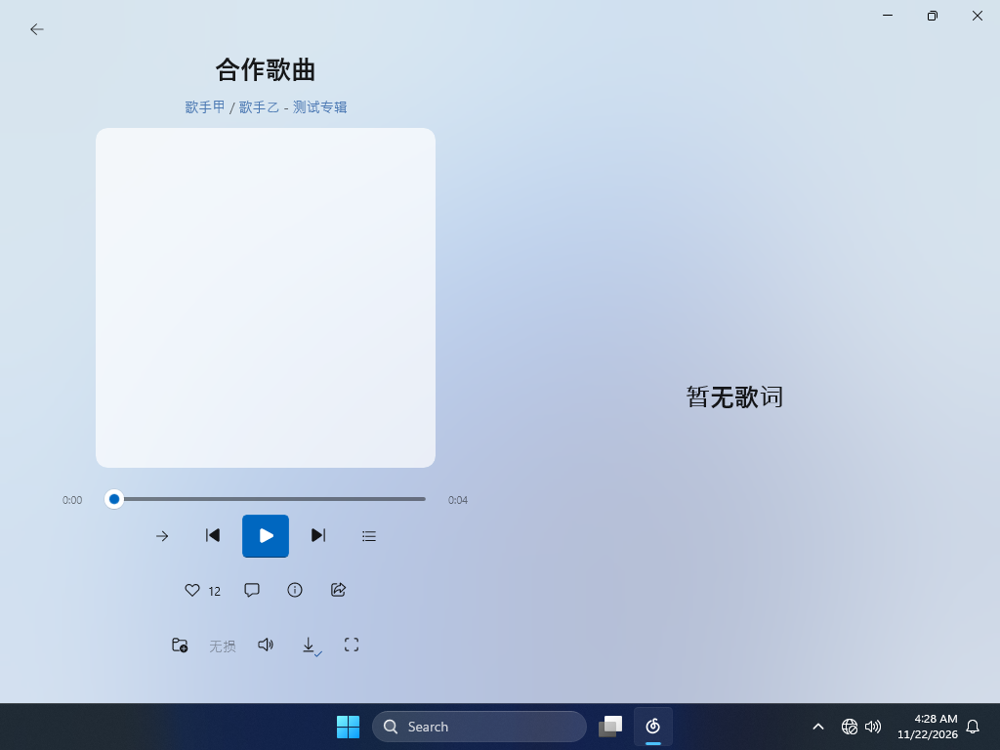
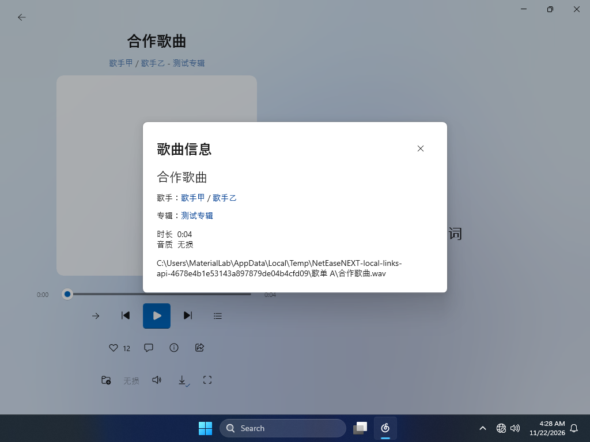
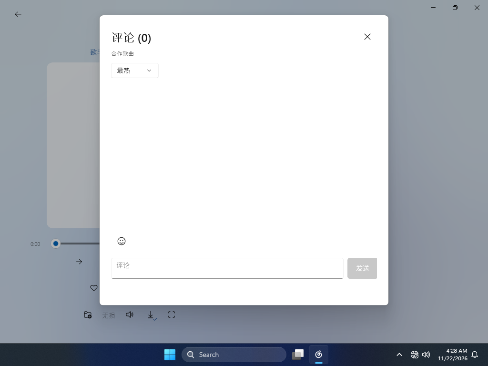
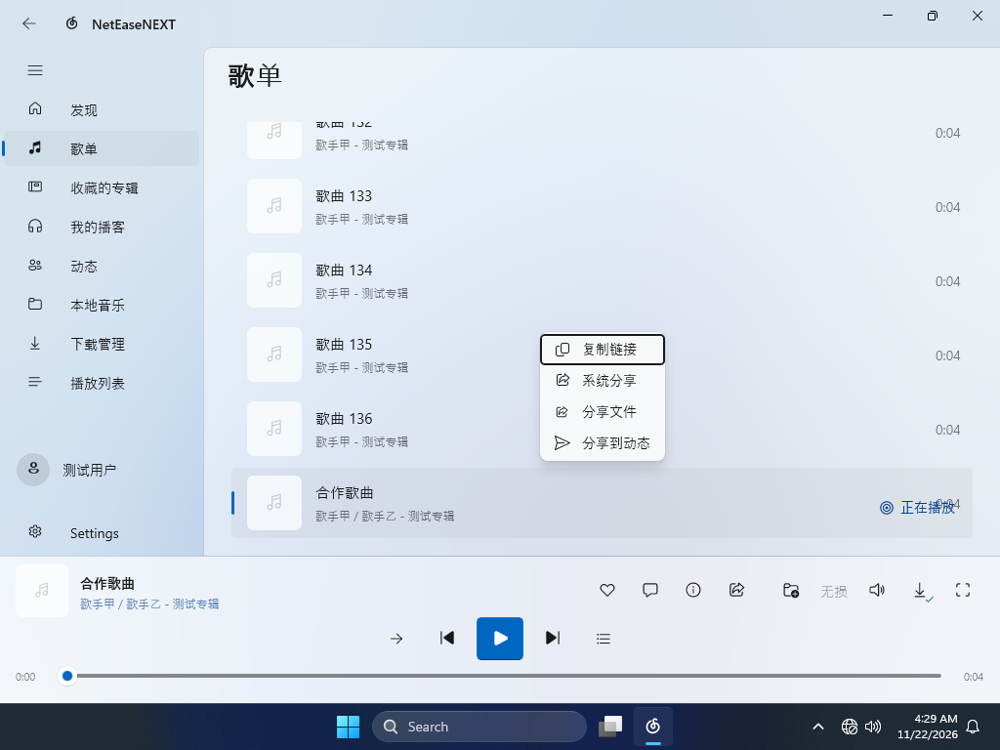
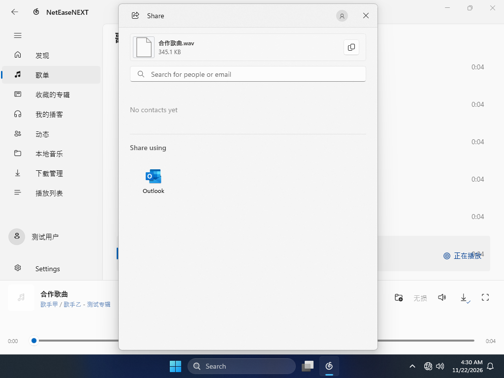

# 0.3.3.15 — 按需资料跳转、链接排版及统一浮层材质

播放器姓名链接此前只设置 TextDecorations，原生 Hyperlink 的 UnderlineStyle 仍保留默认下划线。现在明确使用 UnderlineStyle.None。安装版中将鼠标实际移入歌手姓名、再移到标题处，均未显示残留下划线。[微软 Hyperlink 下划线说明](https://learn.microsoft.com/en-us/windows/apps/develop/ui/controls/hyperlinks#hyperlink-underlines)

本地音乐的歌手及专辑跳转不再以联网配置文件的探测结果决定是否可点击；仍要求用户开启本地联网信息、文件关联的来源身份有效。播放、切页和停留时只呈现已有名称，不预取歌手/专辑元数据。点击缺少 ID 的姓名才请求来源歌曲资料，按所点姓名准确匹配，随后直接进入对应歌手页；不默认跳第一个人。点击歌曲信息时才读取详情，关闭或离开页面取消未完成的解析。无来源的本地文件不猜测在线 ID。

歌曲信息的“歌手：姓名”和“专辑：名称”分别使用同一 TextBlock 内的 Run 与 Hyperlink，字体、字号和基线统一；不再混排标签 TextBlock 与带内部模板的 HyperlinkButton。仍使用右上角无框关闭键。

在线歌曲分享增加点击时的本地绑定检查：下载索引没有记录时，从保存的本地音乐库及该歌曲已知路径中查找，重读文件内嵌来源并验证实际文件，不扫描所有文件夹、不发网络请求、不按同名猜测。重新建立有效记录后，在线歌单歌曲的分享菜单显示“分享文件”。本地歌曲仍分享当前实际副本。

浮层与主窗口采用同一设置与 AdjustableBackdrop 实现。菜单 presenter、评论及详情所属的 Popup 同步选择 Mica / Mica Alt / Acrylic，沿用透明度和系统默认参数；浮层额外增加 12% 的剩余实色混合度，保持更易读。窗口内播放列表继承窗口背景并叠加相同底色；纯色模式与不支持材质时回退纯色。没有将所有材质固定成亚克力，也没有创建截图循环。原生 controller 随弹出目标断开而释放。[微软支持的系统材质目标](https://learn.microsoft.com/en-us/windows/apps/develop/ui/system-backdrops)

Release 构建零警告、零错误；9 组原生回归 **336 项断言**、签名安装版 **39 项专项断言**、API **83 项**全部通过。库报告含另外 15 条字形测量，不计为断言。新增验证覆盖未点击时不请求资料、首次点击解析第二位歌手、网络配置探测失败仍可显式跳转、按需恢复在线歌曲文件分享，以及对话框打开期间切换 Mica / Mica Alt / Acrylic / Solid。MSIX、安装目录和发布目录 DLL 哈希一致，安装状态 Ok、签名 Valid。

人工检查了安装版的姓名悬停与移出、信息排版、评论浮层和在线歌单的歌曲菜单。Windows 文件分享面板显示实际音频文件名和大小，随后关闭，未发送文件或发布动态。测试使用隔离的模拟 API 和音频，无真实账号写入，未做物理触屏测试。虚拟机保留在副屏，已清理本次失效测试目录。

[汇总与哈希](lazy-credits-2026-11-22/summary.json) · [安装版 39 项报告](lazy-credits-2026-11-22/installed-local-links.json)

