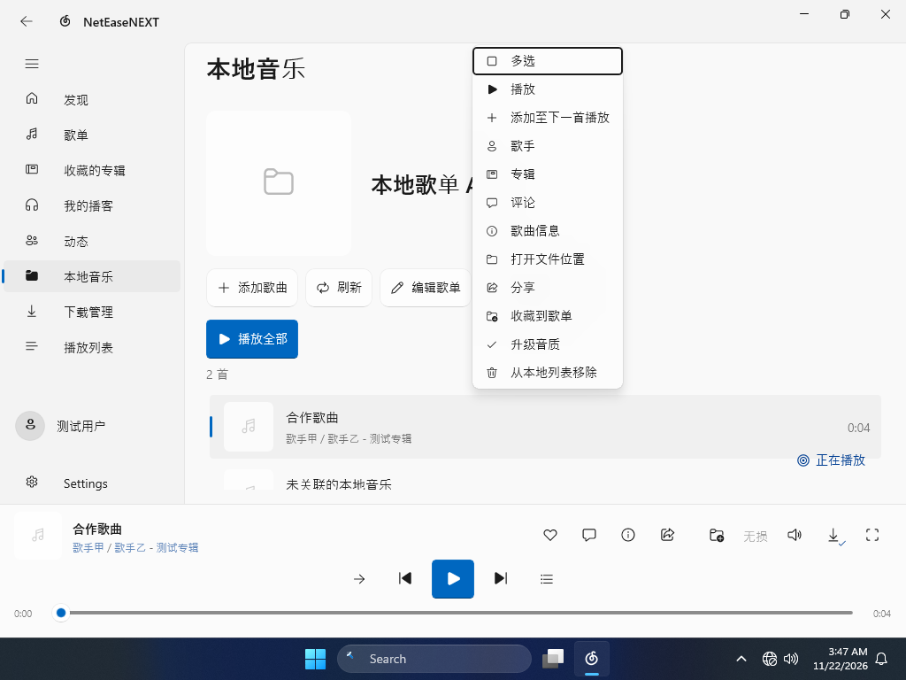
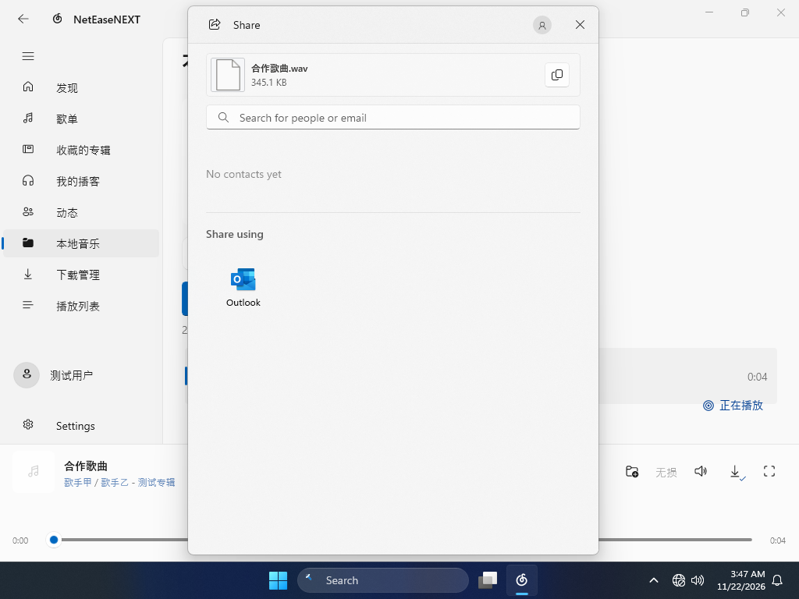
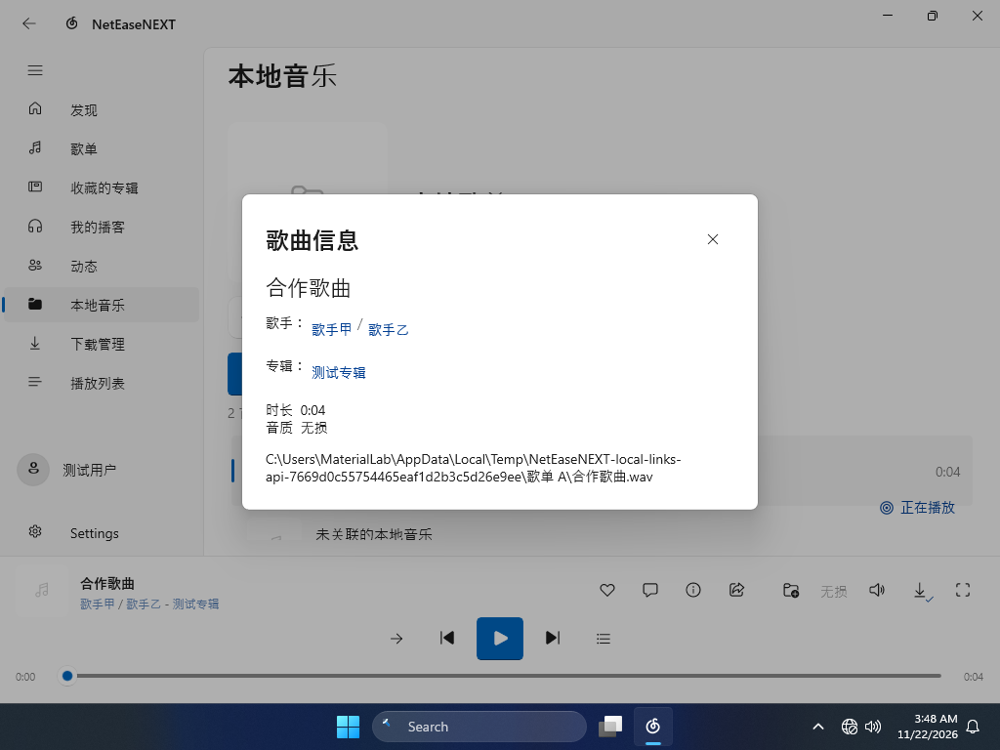
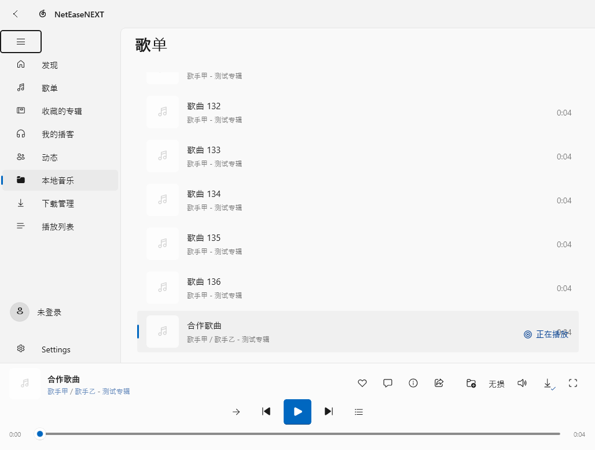

# 0.3.3.14 — 本地歌曲关联、文件分享与姓名跳转

本地下载歌曲通过已验证的源歌曲 ID 匹配在线歌单，包括尚未分页加载的歌曲；只有主动点击定位才滚动。不同文件夹内的同一首歌仍按实际路径区分，不会选中另一个本地歌单的副本，也不改变正在播放的文件。

已下载歌曲的分享菜单增加“分享文件”，使用 Windows StorageItems 交付实际文件。普通离线音频也能分享文件；本地歌曲始终使用当前副本，不会换成其他文件夹或音质的同名歌曲。文件消失时给出提示。[微软 SetStorageItems 文档](https://learn.microsoft.com/en-us/uwp/api/windows.applicationmodel.datatransfer.datapackage.setstorageitems?view=winrt-26100)

本地歌单工具栏、卡片和歌曲菜单补齐 Fluent 图标，提供文件夹、文件位置、信息、歌手、专辑等相应操作。歌曲菜单改为在原生 ContextRequested 事件发生时从 ItemFromContainer 读取实际歌曲，避免虚拟化模板保留旧数据。菜单生命周期随页面和窗口状态结束。[微软 ContextRequested 文档](https://learn.microsoft.com/en-us/windows/windows-app-sdk/api/winrt/microsoft.ui.xaml.uielement.contextrequested?view=windows-app-sdk-1.8)

播放器及底栏将每位歌手分别呈现为原生文字链接，点击姓名直接进入对应歌手页，专辑名直接打开专辑。本地歌曲缺少歌手/专辑 ID 时按已验证的来源补全元数据；关闭本地联网信息或断网时保留普通文字，不猜测跳转目标。歌曲信息使用“歌手：姓名 / 姓名”和“专辑：名称”的文字链接，信息与评论统一使用右上角无框叉号。

发布构建零警告、零错误；签名 MSIX 状态 Valid，虚拟机安装状态 Ok，安装目录 DLL 与最终发布目录一致。9 组原生测试共 **325 项断言**，另有安装包 28 项专项断言、API 合同 83 项，全部通过。库检查报告还保留 15 条字形测量数据，不计入断言数。队列关闭保留退场动画，150ms 后释放绑定，并验证快速重开不会被旧释放任务清空。

原生 Shift+F10 打开歌曲菜单，随后操作“打开文件位置”确实打开当前歌单 A 文件夹。此环境中 Explorer 没有可见地选中文件，因此仅将打开正确文件夹记为人工通过。Windows 分享面板显示实际 WAV 文件名和大小，随后点击关闭，未发送文件或发布动态。人工核对信息对话框和无框关闭键；自动原生调用同时验证第二位歌手、专辑和本地/在线定位。全部使用隔离的模拟 API 与音频，没有真实账号写操作，没有物理触屏实测。

[汇总与 DLL 哈希](local-links-2026-11-22/summary.json) · [安装版专项报告](local-links-2026-11-22/installed-local-links.json)

