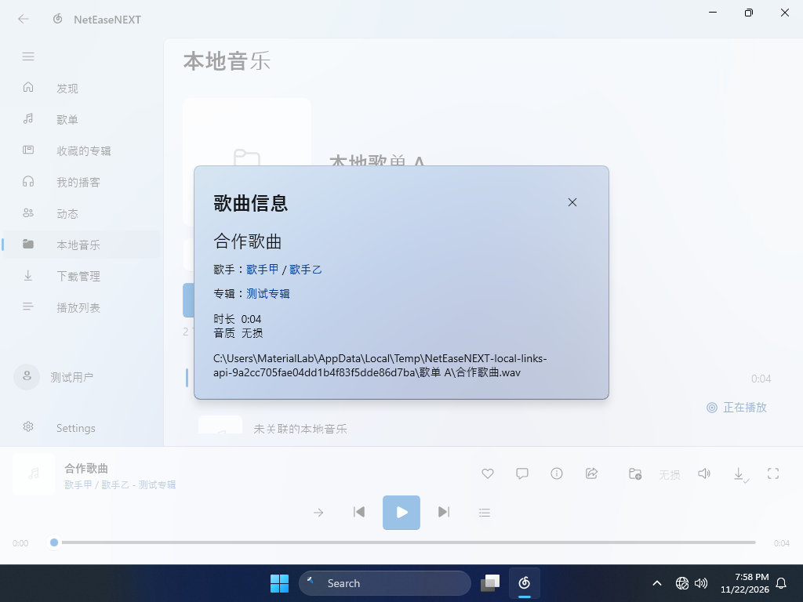
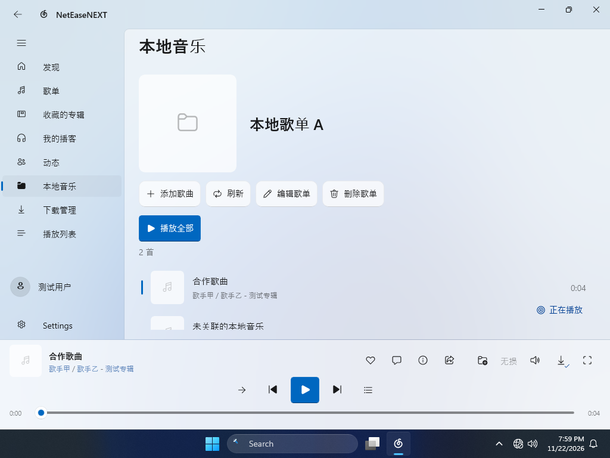
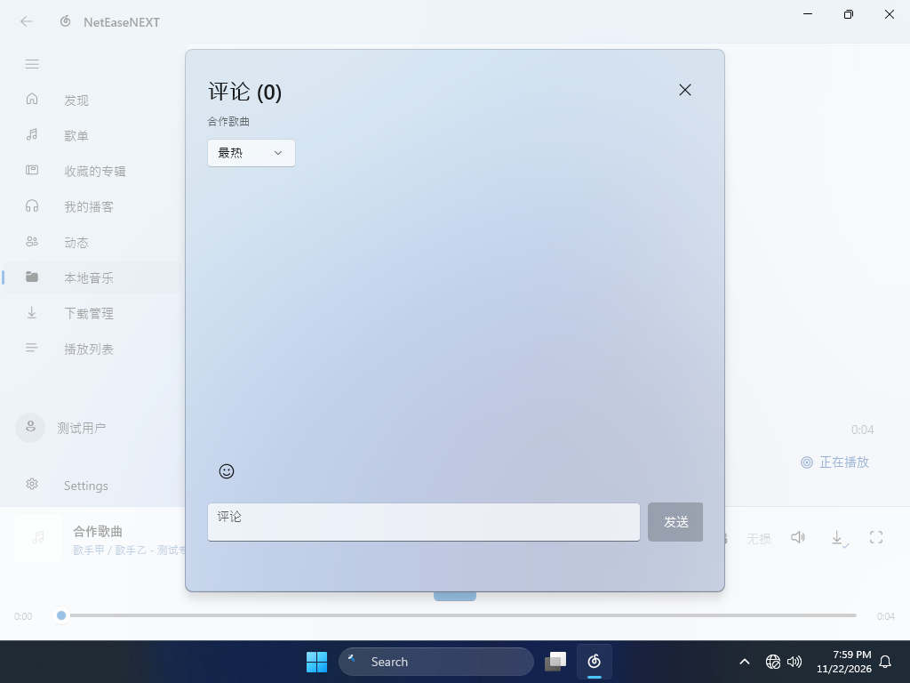
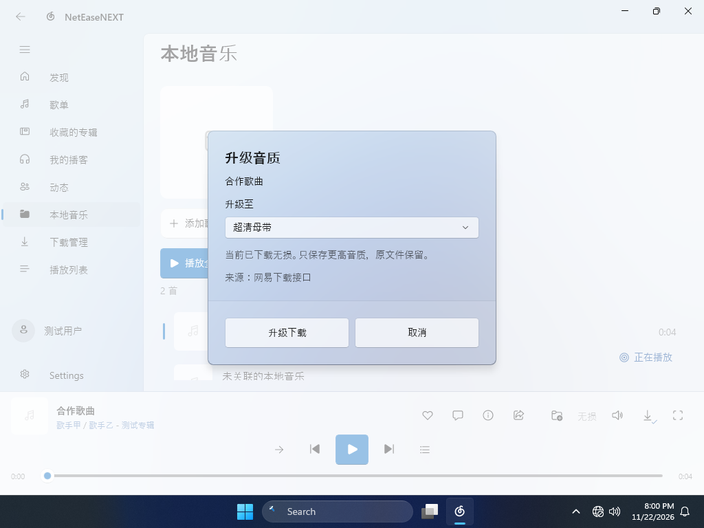

# 浮层描边与点击外部关闭

版本：0.3.3.20。

之前只统一了描边宽度，但 ContentDialog 使用 SurfaceStrokeColorDefaultBrush，菜单使用 SurfaceStrokeColorFlyoutBrush。当前 SDK 默认前者是 40% 的灰色，后者在浅色和深色主题分别为约 6% 和 20% 的黑色，因此相同宽度的轮廓也会明显不同。本次 ContentDialog 改用同一个系统浮层画刷，普通 Flyout 也统一为 0.5 DIP 描边；评论、信息和播放列表的承载 Flyout 不再额外画第二层边框。高对比度下保留 2 DIP。

公共 ShowThemedDialogAsync 默认支持点击外部关闭。原生 Flyout 收到关闭请求时，先调用 ContentDialog.Hide，让其以 None 结果结束，再等待原生浮层退出并清理内容。这样取消表单不会触发保存，取消音质选择不会加入下载，取消删除确认不会移除或删除歌曲；已有调用方的取消请求、播放器和图像释放逻辑继续执行。评论显式关闭此选项，点击外部仍保持评论弹窗。

## 验证

Release 发布构建零警告、零错误。

- 11 组原生回归共 **381 项断言**通过。
- 签名安装版 0.3.3.20：本地关联 42 项、指示条与浮层回归 27 项、外部关闭专项 15 项，共 **84 项断言**通过。
- API 契约 **83 项检查**通过。
- 专项验证浅色、深色主题下，ContentDialog 模板实际 BackgroundElement 与菜单使用相同宽度和相同 ARGB 颜色；关闭后释放原生材质。
- 验证表单取消不会调用保存，勾选“同时删除本地音频文件”后从外部关闭仍保留歌曲和文件，取消下载选项不会创建任务，加载中的歌曲信息会取消请求，嵌套音质下拉菜单不会关闭父弹窗。
- 正常交互模式下实际点击信息弹窗内部后保持打开，点击外部后关闭；实际点击评论外部后评论保持打开。音质选择及评论的截图见下方。交互演示和原生回归使用隔离模拟数据。
- 13 个指示条渲染位置检查仍通过，最大中心误差为 0 像素。

发布及安装目录 NetEaseNEXT.dll SHA-256：

`F1F94C22E1D62759A383255BA99E59603AA922027A05AE812449418ABBD30787`

原始断言和汇总见 [验证目录](light-dismiss-2026-11-23/summary.json)。

## 本机接口诊断

经用户允许，另用本机保存的登录会话做了独立诊断。登录、最近播放读取、红心列表读取均正常。对一首原本已经红心的歌曲发送一次保持红心的请求，服务端返回 **-460**：“检测到您的网络环境存在风险，请稍后再试”。该拒绝没有按成功处理，也没有反复重试或替换身份绕过。

传统播放日志按本机保存的播放记录试报了一次，接口返回 200，但立即和后续读取都未确认播放时间更新。不能把这个响应当作已验证入库。本次界面版本未加入自动播放记录上报；新版 scrobble_v1 桌面日志协议尚未移植验证。真实会话、账号标识、歌曲记录和请求载荷没有写入公开验证文件。
