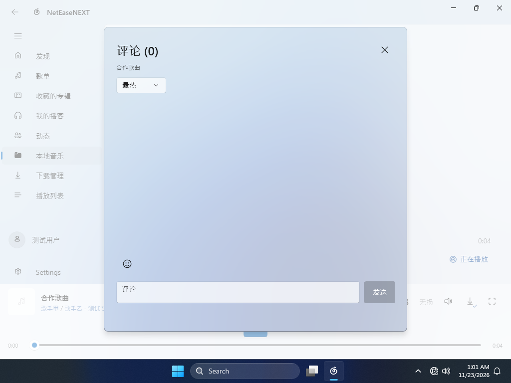
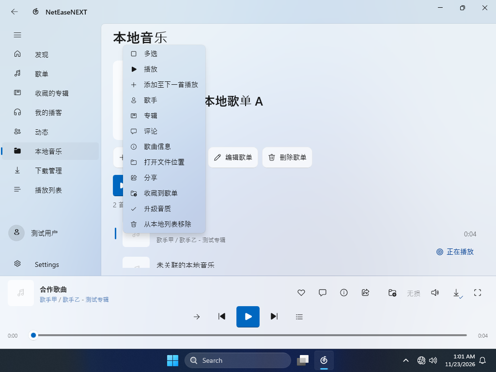
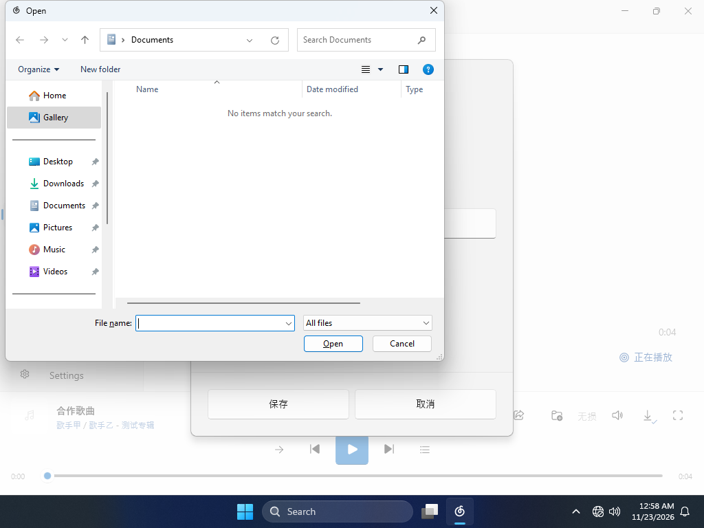
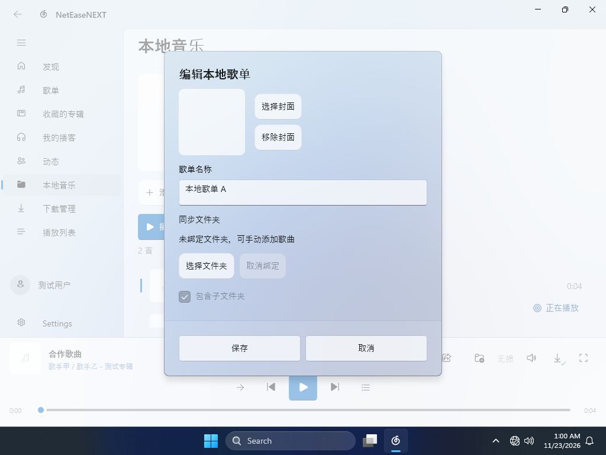

# 系统圆角与物理像素对齐

版本：0.3.3.21，包含之前统一浮层画刷和评论以外弹窗点击外部关闭的改动。

主窗口继续由 DWM 的默认策略决定圆角。菜单、评论、歌曲信息和播放列表仍使用 WinUI 的 OverlayCornerRadius，未另设一套固定圆角。浅色、深色主题下检查了菜单和 ContentDialog 实际模板部件的 CornerRadius，它们相同。

之前固定为 0.5 DIP 的细线，在 100% 缩放下只覆盖半个物理像素，圆角处更容易产生不均匀的覆盖。本次普通浮层改为一个物理像素，即 1 / RasterizationScale DIP，200% 时仍为 0.5 DIP，100% 时为 1 DIP。弹窗位置、尺寸及播放列表浮层位置也对齐物理像素；活动弹窗随 XamlRoot 的缩放变化更新，避免边缘停在半像素。描边画刷继续统一为系统浮层画刷，承载层不额外描边；高对比度保留 2 DIP。

另外保护本地歌单的封面、文件夹选择过程：系统选择器打开期间保留父弹窗，返回后恢复外部关闭，避免选择文件时父表单因失去激活而退出。关闭普通应用弹窗仍以取消结果完成，评论保持外部点击不关闭。

## 验证

Release 构建零警告、零错误；签名安装包身份 0.3.3.21，安装状态 Ok。

- 11 组原生回归共 **385 项断言**通过。
- 签名安装版：本地关联 42 项、指示条/浮层 27 项、外部关闭及像素对齐 19 项，共 **88 项断言**通过。
- API 契约 **83 项检查**通过。
- 在虚拟机实际 100% 缩放下，浅色、深色主题的实际模板描边均为一个物理像素；弹窗横纵坐标均对齐物理像素，菜单和评论的实际颜色、宽度、圆角相同，承载层无第二条描边。测试记录包含实际缩放、描边、圆角、坐标数值。其他缩放按相同公式计算，未在所有屏幕缩放比例逐一实测。
- 普通表单的外部关闭不保存、不添加下载、不删除文件；关闭加载中的信息会取消请求；评论外部点击保持打开；嵌套下拉选择及原生选择器生命周期不会关闭父表单。
- 正常交互模式实际打开了 Windows 原生封面文件选择器。取消选择器后，编辑本地歌单仍打开；随后点击弹窗外部能取消关闭。实际点击评论外部仍保持评论打开，并用鼠标右键打开歌曲菜单观察圆角。
- 13 个指示条渲染位置检查仍通过，最大中心误差为 0 像素。

发布目录与安装目录 NetEaseNEXT.dll SHA-256：

`4FF932421698A493C0BE3E6F98DDCCDF8DAA09E557F5B44FE9A564451A341E31`

原始断言和汇总见 [验证目录](pixel-corners-2026-11-23/summary.json)。

本机登录、红心风控及播放日志试报结果见[上一轮诊断](fixes-2026-11-23-light-dismiss.md#本机接口诊断)。本次没有更改真实账号的红心状态，也没有加入自动播放记录上报。
