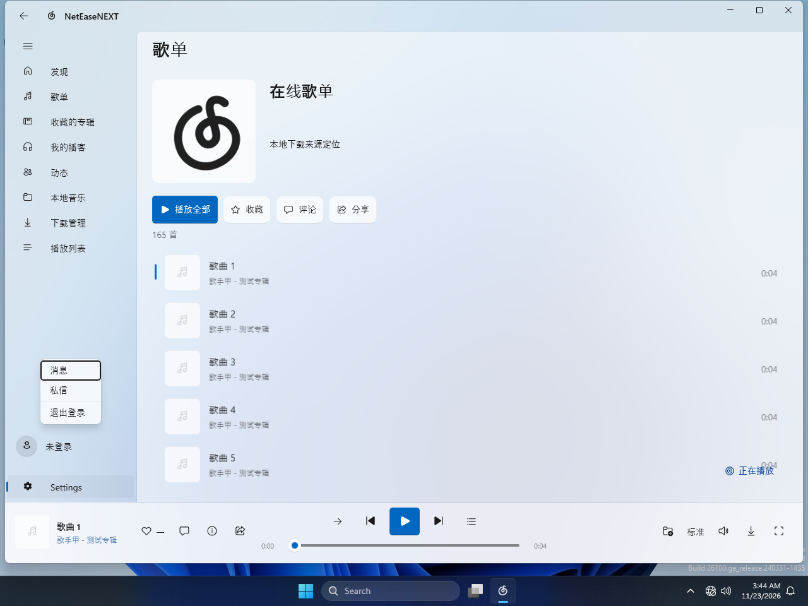
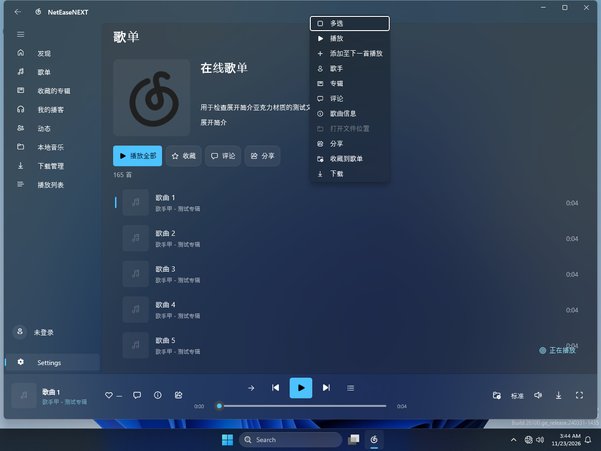
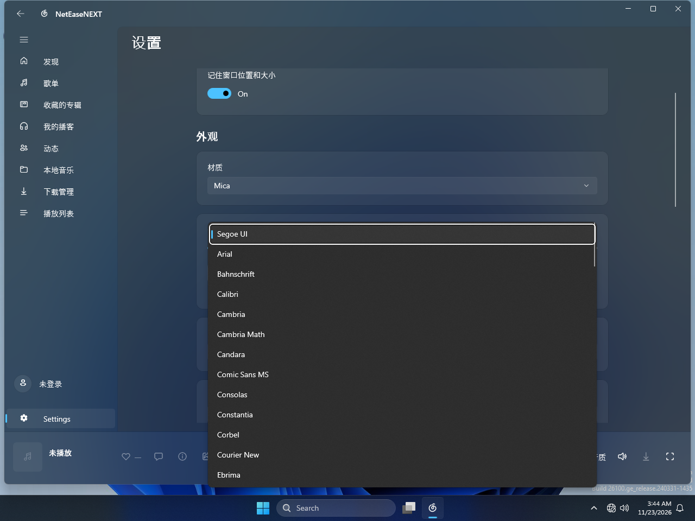
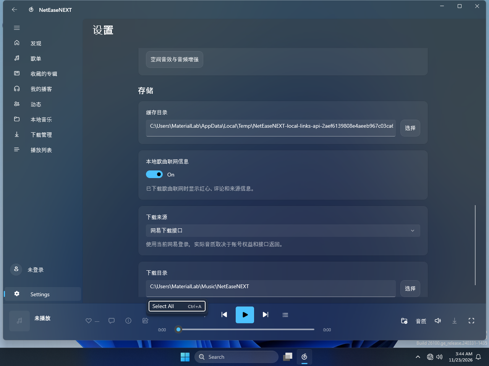

# 主窗口材质恢复、字体下拉与次级浮层

版本：0.3.3.24。

恢复主窗口的 Mica、Mica Alt、Acrylic、纯色四种选择及原先的独立参数。移除 0.3.3.23 加入的强制 Acrylic 和设置迁移，读取设置不再改写材质或透明度。对于此前已经被 0.3.3.23 保存为 Acrylic 的选择，不猜测更早是哪种 Mica；保留现值，用户可在恢复的选择器中改回。

字体下拉框此前在 DropDownOpened 中每次重新扫描系统字体，并直接替换 ItemsSource，导致打开即收起。现在进入设置时按需加载，展开时不重新扫描；手动刷新、字体安装更新如发生在展开期间，先保存结果，收起后才替换列表。缓存一次进行中的扫描，保留当前字体选择，取消无用等待，隐藏时不更新列表。

账号、歌曲右键、歌单右键、音质、分享、音量、表情、简介展开与文本编辑上下文菜单统一接入独立的系统亚克力。普通下拉框和 ContentDialog 保持应用内 AcrylicBrush。独立菜单通过 FlyoutBase.SystemBackdrop 接入系统合成器，正文只画低不透明度衬层；不再把“设置了 AcrylicBrush”当成独立窗口实际拥有亚克力的证明。菜单允许系统窗口承载，临时窗口保持自身的输入激活状态，仍遵守系统高对比度等回退。隐藏/关闭时释放实际控制器。

参考：[FlyoutBase.SystemBackdrop](https://learn.microsoft.com/en-us/windows/windows-app-sdk/api/winrt/microsoft.ui.xaml.controls.primitives.flyoutbase.systembackdrop?view=windows-app-sdk-1.8)。应用的托盘菜单、系统文件/文件夹选择器和系统分享页属于 Windows 自身绘制的界面，保留其系统实现。

## 验证

Release 构建零警告、零错误；签名安装身份 0.3.3.24，状态 Ok；安装版与发布目录 DLL 相同：

`F31BF9C3778EE4FE6856C2A57951D30C046078A612296C0B24ACBE3966B575F7`

最终安装版 **154 项检查**通过：本地来源关联 42 项，次级浮层/字体/主窗口材质 45 项，外部关闭及下拉框 40 项，评论与指示条 27 项。API 契约 **83 项**通过。详见 [汇总](secondary-surfaces-2026-11-23/summary.json)。

在 Windows 11 VirtualBox 3D、1280×960、100% 缩放下实际展开并采集 **19 张桌面截图**：8 类浮层各浅/深色两张、字体刷新后保持展开及重复展开两张、文本编辑菜单一张。检查了实际接入的合成控制器、透明正文、独立主窗口选择，以及关闭后的控制器断开。未在每一种物理显卡或缩放逐一实测。

扩大虚拟机显示区域后，原指示条测量暴露了 UI Automation 把列表行包围框裁到视口的情况：76 DIP 行可只报告 68 DIP，错误地把可见片段中心当成整行中心会相差 4 像素。本次仅修正测量方法，使用整行在截图坐标中的位置，继续独立检测实际渲染的标记像素；未改变指示条产品实现或放宽 2 像素阈值。

