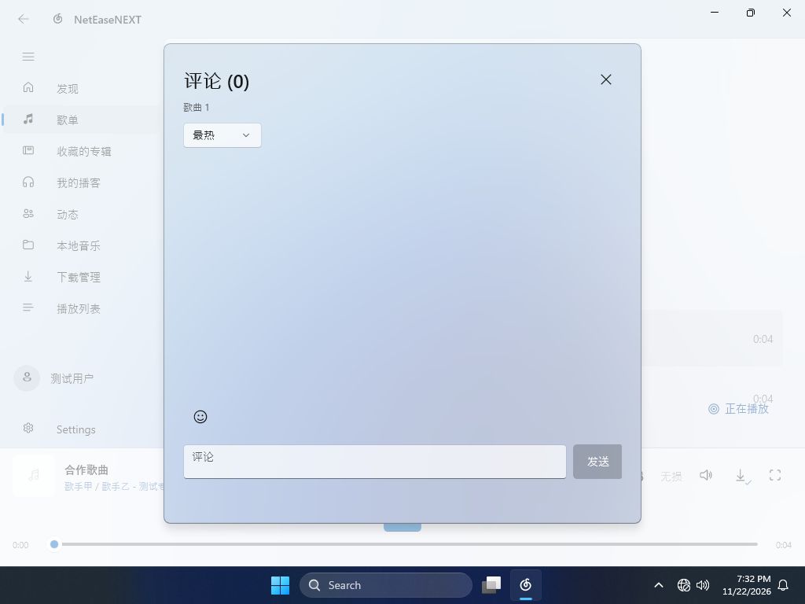
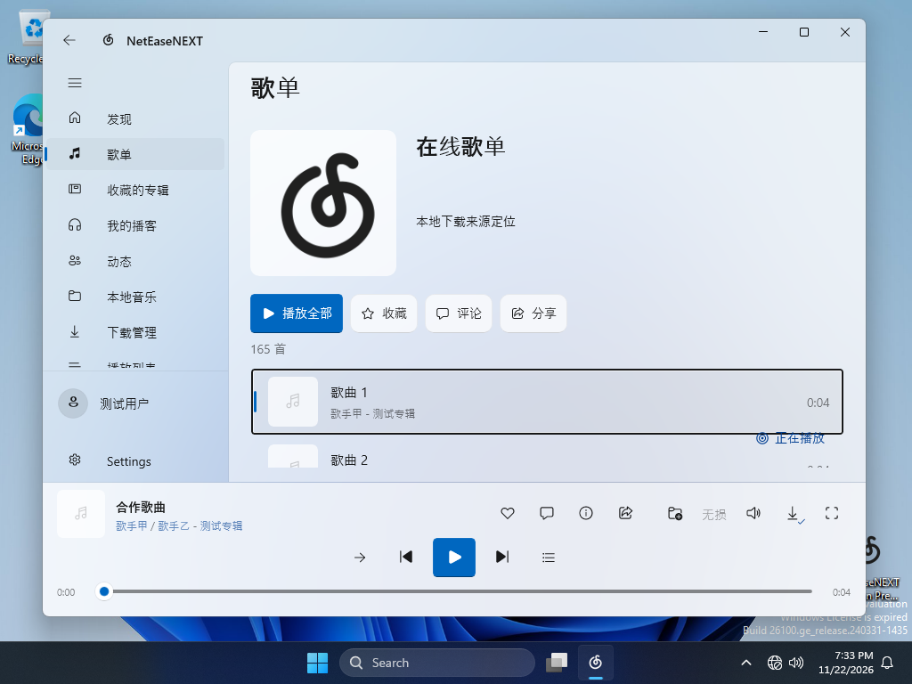
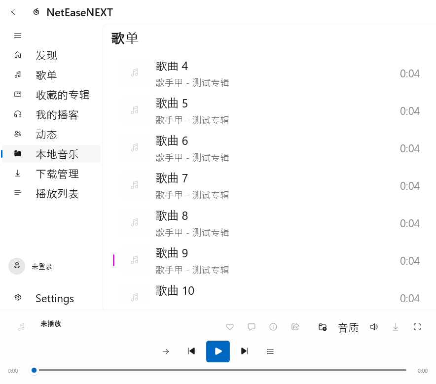

# 指示条与浮层修复

版本：0.3.3.19。

歌曲与播放列表的指示条直接使用 ScrollViewer 内容坐标计算锚点，保留合成器的实时滚动跟随和切歌拉伸动画；不再把列表视口坐标与另一时刻读取的 VerticalOffset 相加。裁剪区域仍从歌曲行开始，不穿过歌单封面。播放同步仍不会主动定位或滚动页面。

用户机器日志中的评论闪退发生在 `ContentDialog.ShowAsync(ContentDialogPlacement.InPlace)`，异常为 `ArgumentException: Value does not fall within the expected range`，随后从 `ContextComments_Click` 的异步事件传出。现在菜单动作等待原生菜单的 Closed 事件，浮层宿主等待 Opened 后再显示 ContentDialog，并使用已挂载宿主的 XamlRoot。评论点击入口捕获异常，避免它穿出事件循环。关闭、请求取消和失败重试继续使用原生评论逻辑。

主窗口使用 `DWMWA_WINDOW_CORNER_PREFERENCE = DWMWCP_DEFAULT`，保留原生窗口框架；普通、最大化等状态交由 DWM 决定。播放列表浮层改用 WinUI 的 OverlayCornerRadius，菜单和 ContentDialog 保留同一系统主题资源的圆角。封面圆角不受影响。依据：[微软 DWM 圆角文档](https://learn.microsoft.com/en-us/windows/apps/desktop/modernize/ui/apply-rounded-corners)。

菜单、评论、详情与播放列表浮层的描边改为 0.5 DIP，使用现有系统边框画刷；高对比度下保留 2 DIP。原有 Mica / Mica Alt / Acrylic、透明度及融合度设置不变。

## 验证

Release 发布构建零警告、零错误。Windows 11 3D 虚拟机使用隔离模拟接口和静音音频，没有写入真实账号。

- 发布目录中的 10 组原生回归共 **366 项断言**通过。
- 签名 MSIX 安装版本 0.3.3.19，状态 Ok；安装目录中的本地关联 42 项和本次专项 27 项，共 **69 项断言**通过。
- 纯 C# API **83 项检查**通过。
- 13 个指示条检查比较 RenderTargetBitmap 实际渲染的指示条像素中心与原生 UI Automation 歌曲行中心，最大误差 **0 像素**。覆盖字号 14/22、窗口宽度 900/1000/1280、列表滚动、已滚动状态下改变宽度，以及播放列表浮层。测试暂时将指示条设为洋红色以独立识别像素，正常运行仍使用系统强调色。
- 原实现也能通过静止后的基础矩阵；本次坐标调整消除了两套滚动坐标的混用。上述结果覆盖所列尺寸和稳定渲染帧，不代表穷举连续拖拽、触控惯性与所有 DPI 的每一帧。
- 原生菜单专项覆盖在线歌曲、关联本地歌曲、连续打开、失败重试、加载中关闭取消请求、原生材质连接和关闭后释放。
- 另外在安装版正常交互模式下，通过实际歌曲行的 Shift+F10 菜单选择“评论”，分别打开本地来源 137 和在线歌曲 1；标题显示所点歌曲，均加载为“评论 (0)”，未退出。普通窗口与最大化状态进行了实际截图检查。

发布、安装目录的 `NetEaseNEXT.dll` SHA-256 均为：

`1852DDF698E155B6A7B8D9B20245B95032FCB9236CAAC4C6A2D9F8B2F35CEBF8`

断言、像素测量和汇总见 [验证目录](surface-fixes-2026-11-23/summary.json)。

验证完成后清理了四个已停用的临时应用运行目录；虚拟机保留已安装的正常交互预览。
