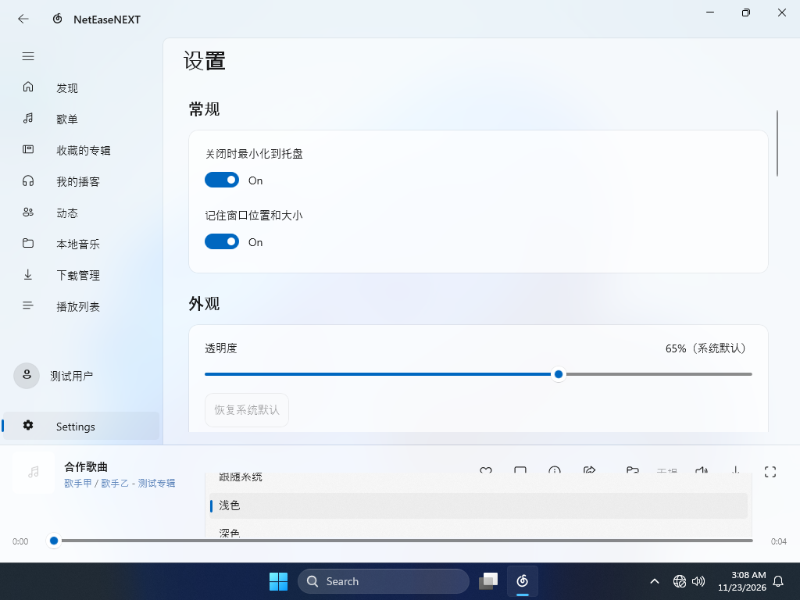
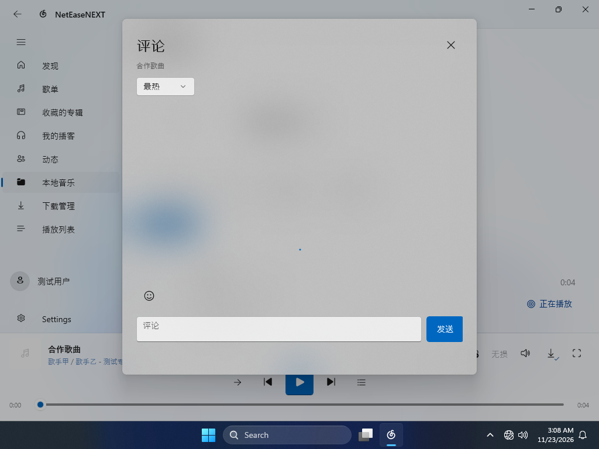
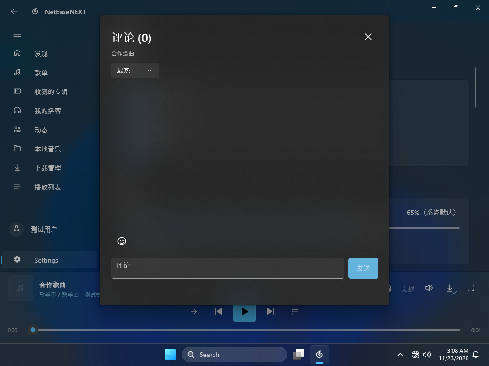

# 统一亚克力与单层弹窗

版本：0.3.3.23。

主窗口固定使用 DesktopAcrylicController；菜单、评论、歌曲信息、播放列表浮层及 ComboBox 下拉框统一使用 WinUI AcrylicBrush。选择框在展开之前配置下拉模板资源，展开时再检查实际 PopupBorder，避免只修改页面背景、遗漏下拉列表。保留透明度与恢复系统默认；旧 Mica/Mica Alt 配置迁移当前透明度到亚克力，旧纯色配置迁移为 0%。移除材质选择器。

ContentDialog 直接使用原生 ShowAsync，不再包一层额外的 Flyout，也不再先显示承载层、等待材质控制器准备之后才展示内容。背景、圆角、标题、关闭按钮和正文使用同一原生弹窗入场过程；网络评论仍异步加载。正常主题浮层保持一物理像素描边，菜单和评论使用同一系统浮层描边画刷；高对比度保留系统回退。

原生 ContentDialog 会把 SmokeLayerBackground 移到独立输入 Popup，所以外部点击监听同时覆盖该输入层。关闭以 None 结果完成，不保存、不排队、不删除文件；评论不响应外部关闭。嵌套音质选择和系统文件选择器保持父表单，结束后卸载处理函数。

主窗口圆角仍由 DWM 决定，浮层采用 WinUI 原生 OverlayCornerRadius。二者是不同 API 的原生策略，不能把控件圆角资源直接等同于 DWM 的窗口裁剪；本次取消额外承载层，未另做一套窗口圆角或描边。

参考：[Microsoft 的应用内亚克力说明](https://learn.microsoft.com/en-us/windows/apps/develop/ui/in-app-acrylic)、[ContentDialog 的原生输入层实现](https://github.com/microsoft/microsoft-ui-xaml/blob/main/dxaml/xcp/dxaml/lib/ContentDialog_Partial.cpp)。

## 验证

Release 构建零警告、零错误，签名安装包身份 0.3.3.23，安装状态 Ok。安装目录 DLL 与发布目录一致：

`FDC9ED6523D53A7AF27609532B385F5178E2684557A43190FF99FF51D2817405`

最终签名安装版共 **107 项原生检查**通过：本地歌曲关联与分享 42 项；评论、指示条和浮层回归 27 项；主题、选择框、透明度、关闭和嵌套选择器 38 项。API 契约 **83 项**通过。原始报告见 [summary.json](unified-acrylic-2026-11-23/summary.json)。

在 Windows 11 VirtualBox 3D、1024×768、100% 缩放下进行了真实鼠标检查：点击歌曲信息之外会关闭，点击评论之外保持打开。信息、浅色评论和深色评论各采集 32 张原生桌面帧，间隔约 33–60 ms；首次可见帧已经含标题、关闭按钮和正文/加载状态，未观察到额外空浮层或黑色过渡帧。保留首帧、首次可见帧、稳定帧及每帧时间。结论覆盖此次采样，不代表所有物理显卡与缩放均已实测。

