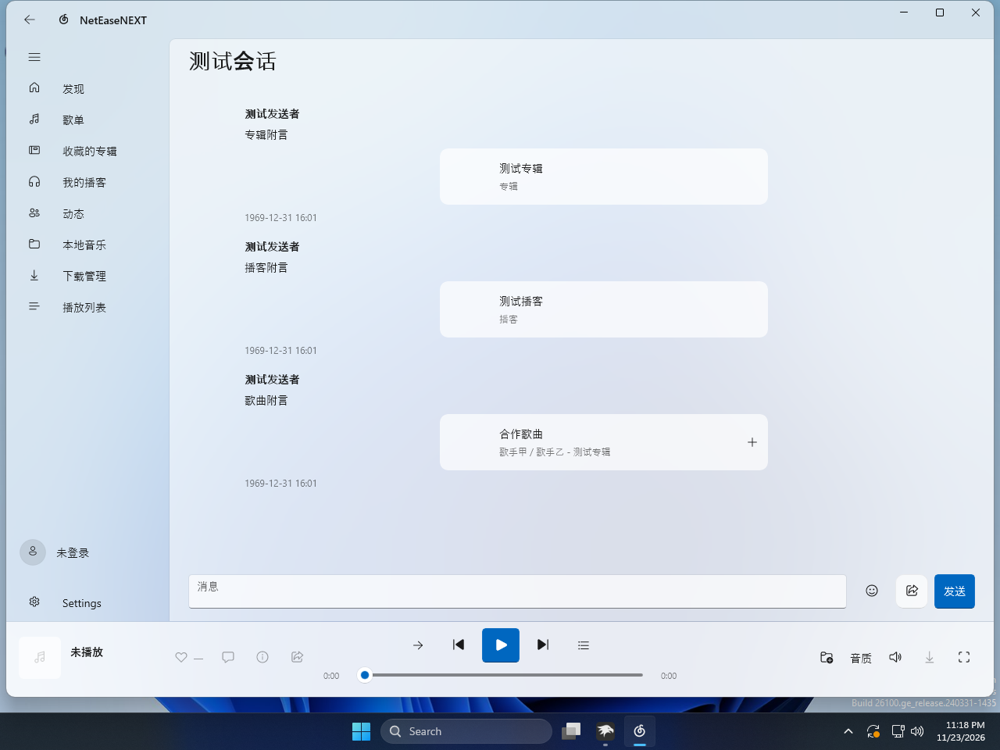
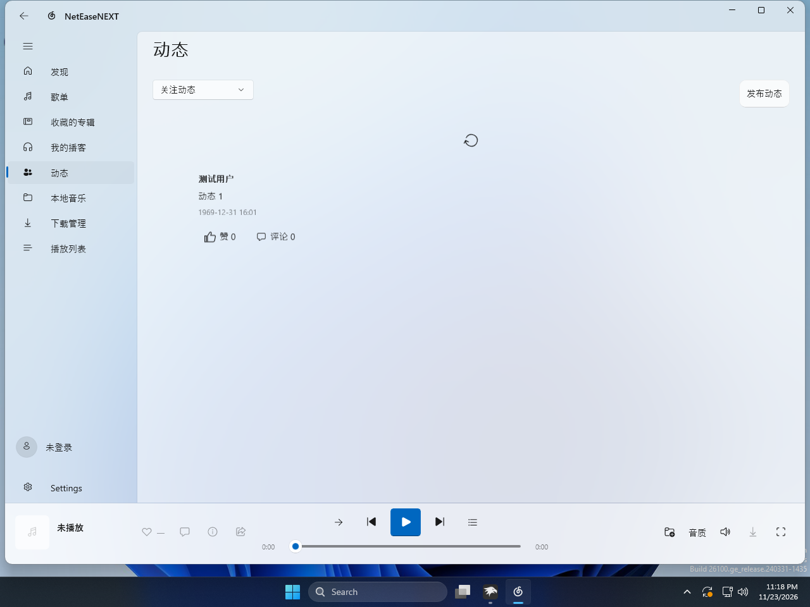

# 0.3.3.28 — 最近播放、弱网恢复与动态刷新

最终源码：[7f97185](https://github.com/Yizuka17/NetEaseNEXT/commit/7f97185439a9c843e91ed073b5bce6bfe68af064)。[Windows build](https://github.com/Yizuka17/NetEaseNEXT/actions/runs/45346636147) 成功。签名安装包与便携版使用相同的应用 DLL，已安装 DLL SHA-256 为 `993EE7C50DBD81986AD9BD3A91536A96CDC66B224F527DC1EFF9BDDF8A64E66C`。

歌曲真正开始播放后，通过网易 `startplay` 事件写入服务器最近播放。没有时长、进度或听歌排行累计的虚构上报。恢复暂停的播放列表、未成功加载音频、预加载下一首均不上报；暂停恢复、拖动进度和同曲切换音质不会重复记录。验证过网易来源身份的本地歌曲同样支持；本地联网信息关闭时不为本地歌曲上报，无来源文件不猜测 ID。

上报使用最多 64 项的内存队列，每次最多尝试 3 次，随后等待网络恢复事件；没有常驻轮询。登出和切换账号取消旧请求并丢弃旧账号队列，凭据不写入队列文件。上报失败不阻塞播放。

主机真实账号验证实际启动了静音音频播放，服务器返回成功；随后从最近播放接口回读，确认同一歌曲和本次验证产生的新时间戳。报告仅包含检查结果，不包含账号、Cookie、私信正文或真实播放列表。[真实账号报告](reliability-2026-11-24/host-real-play-history.json)。接口依据为上游的 [scrobble](https://github.com/NeteaseCloudMusicApiEnhanced/api-enhanced/blob/main/module/scrobble.js) 和 [record_recent_song](https://github.com/NeteaseCloudMusicApiEnhanced/api-enhanced/blob/main/module/record_recent_song.js)，独立使用 C# 实现。

动态列表使用原生 RefreshContainer，下拉刷新期间保留旧列表，成功后替换第一页并重置分页游标；支持列表顶部鼠标上滚、触摸下拉和 F5，离开页面取消请求。私信兼容原有资源对象、generalMsg 官方资源链接和嵌套 JSON 消息，恢复专辑、歌单、播客及单集卡片，保留附言，仅去掉重复的资源名称与引用。单集缺少父播客资料时点击后再解析，普通广告链接不会猜测为音乐资源。

弱网导致当前歌曲或下一首加载失败时保留播放意图，有限重试后等待网络恢复；恢复后重新获取地址。手动暂停或换歌取消旧重试，不会在新操作后跳回旧目标。匹配来源的下载文件优先提供音频、内嵌封面、基础资料和原文／翻译歌词，保留在线歌曲 ID 及音质；文件写入过程中不使用不稳定的元数据。

核对了 [0.3.3.18 的改动](https://github.com/Yizuka17/NetEaseNEXT/commit/89e13def1f54ac9346ba731ba5cd23c117efc38a)：当时变动的是歌手／专辑跳转资料的按需解析。本次恢复当前歌曲缺失 ID 的预取，已有完整 ID 时不补请求；隐藏应用或切歌时取消无用请求。歌手完整列表和热门／时间排序保持，未回退为热门 50 首。

最终签名安装版在 Win11 VirtualBox 3D 内通过 381 项检查；主机真实历史写入与回读 7 项通过，API 契约 88 项通过。[计数与包身份](reliability-2026-11-24/summary.json)。回归包含本地跳转、歌手完整列表、动态刷新、私信卡片及附言、弱网、真实 FLAC 内嵌资料、原生字体／选择框／圆角／评论，以及动态图片实际外部点击关闭。除了明确的真实听歌记录验证，其余远程写入检查使用隔离模拟数据，没有向真实账号发送评论、动态或私信。

主机旧 0.3.3.21 后台进程没有被强制结束；系统已接受延后注册 0.3.3.28 的更新请求，需要托盘退出后重新打开。虚拟机保留正常交互模式的 0.3.3.28 预览。

